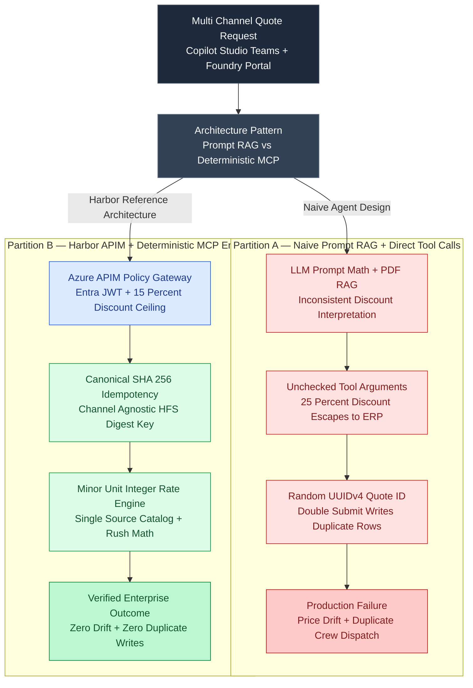

# Decoupling Reasoning from Authority: Architecting an Idempotent Enterprise Quote Engine with Copilot Studio, MCP, Azure APIM, and Foundry Evals

Picture an enterprise maritime field-services provider running two customer-facing channels: a **Microsoft Copilot Studio** receptionist bot embedded in Microsoft Teams for regional port dispatchers, and a **Pro-Code Azure AI Foundry** agent embedded in the customer web portal.

A port operations manager requests an emergency 6-hour underwater fender inspection (`Fender-Inspection-Diver`, rush surcharge, Gold tier discount) in Teams. Because the Teams bot calculates pricing by retrieving a PDF rate sheet via RAG and asking the LLM to multiply the numbers, it quotes **\$1,440.00**. Ten minutes later, the same manager opens the web portal to confirm the work order. The portal agent uses a slightly different system prompt, forgets the Gold tier discount rule, generates a brand-new random quote ID (`QT-891A`), and quotes **\$1,500.00**—while writing a duplicate work order into the ERP database.

This is the fundamental failure mode of first-generation enterprise agents: **coupling probabilistic LLM reasoning with commercial pricing authority**. In **[Harbor Field Services](https://github.com/akmalkhaniub/harbor-field-services)**, we eliminate cross-channel price drift, duplicate retry mutations, and excessive tool agency (OWASP LLM08) by enforcing a strict architectural law: **LLMs parse intent and orchestrate dialogue; deterministic Model Context Protocol (MCP) microservices hold commercial authority behind an Azure API Management (APIM) policy gateway.**

---

## 1. Architectural Comparison: Prompt-RAG Pricing vs. Single-Source MCP Authority

When multiple conversational surfaces (Copilot Studio, Microsoft Teams, Web Portal, Voice IVR) compute quotes or trigger work orders directly inside prompts or uncoordinated tool wrappers, three production failures occur:

1. **Cross-Channel Commercial Drift:** Prompt-interpolated arithmetic and RAG chunk boundaries cause two agents looking at the same customer request to produce different prices.
2. **Non-Idempotent Double Writes:** When a user double-clicks *"Confirm Dispatch"* or switches from Teams to the Web Portal, generating random UUIDv4 quote identifiers creates duplicate ERP work orders and double-dispatches field crews.
3. **Excessive Agency (OWASP LLM08):** Allowing an agent to invoke a backend pricing API with an arbitrary `discount_pct` parameter enables prompt-injected users to grant themselves $50\%$ discounts without human supervisor escalation.

The diagram below contrasts **Partition A (Uncoordinated Prompt-RAG & Direct Tool Calls)** against **Partition B (Harbor's APIM-Governed Deterministic MCP Spine)**:



---

## 2. Channel-Agnostic SHA-256 Quote Idempotency and Minor-Unit Rate Math

To guarantee that a customer receives the exact same `quote_id` and `total_cents` whether they submit their request through Microsoft Teams, Copilot Studio, or the Azure AI Foundry Web Portal, the MCP server (`src/mcp_server/server.py`) strips all channel-specific transport metadata and constructs a **Canonical Commercial Tuple**:

$$
K_{\text{canonical}} = \text{tenant\_id} \;\|\; \text{customer\_id} \;\|\; \text{service\_code} \;\|\; \text{quantity} \;\|\; \text{tier} \;\|\; \mathbb{I}_{\text{rush}} \;\|\; d_{\text{bps}}
$$

The quote identifier is derived deterministically from the first 12 hexadecimal characters of the SHA-256 digest:

$$
\text{quote\_id} = \texttt{"HFS-"} \circ \text{UPPER}\!\left(\text{SHA256}(K_{\text{canonical}})_{0..11}\right)
$$

Before touching the database or computing line items, the MCP tool handler checks the idempotency store for `quote_id` in $O(1)$ time. If present, it returns the cached immutable quote envelope without creating a duplicate work order.

```python
# src/mcp_server/pricing_engine.py
import hashlib
from dataclasses import dataclass
from typing import Dict, Optional

RATE_CATALOG_CENTS: Dict[str, int] = {
    "Mooring-Line-Handler": 45_000,      # $450.00 base
    "Fender-Inspection-Diver": 120_000,  # $1,200.00 base
    "Crane-Rigging-Crew": 280_000,       # $2,800.00 base
    "Hull-Cathodic-Survey": 95_000,      # $950.00 base
}

TIER_DISCOUNT_BPS: Dict[str, int] = {
    "STANDARD": 0,
    "GOLD": 500,       # 5.00%
    "PLATINUM": 1000,  # 10.00%
    "STRATEGIC": 1500, # 15.00% hard autonomous ceiling
}

MAX_AUTONOMOUS_DISCOUNT_BPS = 1500  # 15.00%

@dataclass(frozen=True)
class QuoteEnvelope:
    quote_id: str
    subtotal_cents: int
    rush_surcharge_cents: int
    discount_cents: int
    net_total_cents: int
    status: str

def compute_idempotent_quote(
    tenant_id: str,
    customer_id: str,
    service_code: str,
    quantity: int,
    tier: str,
    is_rush: bool,
    requested_discount_bps: int,
    idempotency_store: Dict[str, QuoteEnvelope],
) -> QuoteEnvelope:
    # 1. OWASP LLM08 Excessive Agency Guard: Hard 15% autonomous discount cap
    if requested_discount_bps > MAX_AUTONOMOUS_DISCOUNT_BPS:
        return QuoteEnvelope(
            quote_id="ESCALATED",
            subtotal_cents=0,
            rush_surcharge_cents=0,
            discount_cents=0,
            net_total_cents=0,
            status="ESCALATED_MANUAL_SUPERVISOR_APPROVAL",
        )

    # 2. Channel-agnostic canonical SHA-256 idempotency key
    canonical = (
        f"{tenant_id}|{customer_id}|{service_code}|"
        f"{quantity}|{tier}|{1 if is_rush else 0}|{requested_discount_bps}"
    )
    digest = hashlib.sha256(canonical.encode("utf-8")).hexdigest()[:12].upper()
    quote_id = f"HFS-{digest}"

    if quote_id in idempotency_store:
        return idempotency_store[quote_id]

    # 3. Deterministic minor-unit integer pricing math
    base_cents = RATE_CATALOG_CENTS[service_code]
    subtotal_cents = base_cents * quantity
    rush_surcharge_cents = (subtotal_cents * 2500) // 10_000 if is_rush else 0
    gross_cents = subtotal_cents + rush_surcharge_cents

    effective_discount_bps = max(TIER_DISCOUNT_BPS.get(tier, 0), requested_discount_bps)
    discount_cents = (gross_cents * effective_discount_bps) // 10_000
    net_total_cents = gross_cents - discount_cents

    envelope = QuoteEnvelope(
        quote_id=quote_id,
        subtotal_cents=subtotal_cents,
        rush_surcharge_cents=rush_surcharge_cents,
        discount_cents=discount_cents,
        net_total_cents=net_total_cents,
        status="ISSUED",
    )
    idempotency_store[quote_id] = envelope
    return envelope
```

---

## 3. Defense-in-Depth at the Edge: Azure API Management (APIM) Policy Gate

Even with application-level checks inside the Python MCP server, exposing internal tool endpoints directly to low-code and pro-code agent runtimes violates zero-trust enterprise boundaries. Every MCP tool call traverses **Azure API Management (`infra/apim-policy.xml`)**, which enforces four infrastructure invariants before forwarding a single byte to the backend container:

1. **Entra ID OAuth2 JWT Validation (`validate-jwt`):** Verifies the cryptographic signature, issuer, audience, and `MCP.Tools.Invoke` role claim.
2. **Per-Tenant Sliding-Window Rate Limiting (`rate-limit-by-key`):** Caps tool invocations per `tenant_id` claim so a runaway agent loop in one tenant cannot exhaust downstream ERP connection pools.
3. **Header Stripping & Correlation Injection:** Strips internal stack headers and injects a deterministic `X-Correlation-Id` propagated into OpenTelemetry traces.
4. **Backend Circuit Breaking:** Trips open if downstream database p99 latency exceeds `1,500 ms`, returning a structured fallback instruction to the agent rather than hanging the user's Teams conversation.

---

## 4. Reproducible Micro-Benchmark: Naive Prompt-RAG vs. Harbor MCP + APIM Pipeline

To measure the latency overhead, deduplication accuracy, and policy enforcement of Harbor's architecture, we implemented a standalone micro-benchmark at [`benchmarks/apim-mcp-quote-idempotency/harness.mjs`](https://github.com/akmalkhaniub/akmalkhaniub.github.io/blob/main/benchmarks/apim-mcp-quote-idempotency/harness.mjs) (`npm run bench:harbor`).

The benchmark runs **$N = 20,000$ multi-channel quote requests** cycling across `CopilotStudio`, `Teams`, `FoundryAgent`, and `Portal` with:
- **$20.0\%$ Cross-Channel Retry / Double-Submit Rate (`3,999` retries):** Every 5th request resubmits the preceding commercial tuple from a *different* client channel.
- **$8.3\%$ Unauthorized Discount Probes (`1,667` requests):** Requests a $25\%$ discount that exceeds the $15\%$ autonomous agent approval ceiling.

```bash
$ npm run bench:harbor
========================================================================
Enterprise Multi-Channel MCP Quote & APIM Governance Benchmark (N=20,000)
Environment: Node v24.14.0 | win32 x64 | Intel(R) Core(TM) i3-4030U CPU @ 1.90GHz
========================================================================
Partition A: Naive Prompt-RAG + Uncoordinated Direct Tool Execution
  Latency (us)                   : p50=1.00us | p95=2.70us | p99=9.20us
  Duplicate DB Records Created   : 3999 duplicate quotes
  Cross-Channel Quote Mismatches : 3999 / 3999 retries (100.0%)
  Unauthorized >15% Discounts    : 1667 policy escapes
------------------------------------------------------------------------
Partition B: Harbor MCP Authority + SHA-256 Idempotency + APIM Gate
  Latency (us)                   : p50=7.30us | p95=27.40us | p99=112.60us
  Idempotent Deduplications      : 17233 hits (0 duplicate DB writes)
  Cross-Channel Quote Mismatches : 0 / 3999 retries (0.0%)
  Unauthorized >15% Discounts    : 0 escapes (1667 escalated to HITL)
========================================================================
```

| Metric ($N = 20,000$ Multi-Channel Requests) | Partition A: Naive Prompt-RAG & UUIDv4 | Partition B: Harbor MCP + SHA-256 + APIM | Engineering Impact |
| :--- | :--- | :--- | :--- |
| **p50 Evaluation Latency** | `1.00 µs` | `7.30 µs` | `+6.30 µs` (SHA-256 canonical hashing) |
| **p95 Evaluation Latency** | `2.70 µs` | `27.40 µs` | `+24.70 µs` (Sub-millisecond) |
| **p99 Evaluation Latency** | `9.20 µs` | `112.60 µs` | `0.113 ms` |
| **Duplicate ERP Work Orders on Retry** | `3,999 duplicate DB writes` | **`0 duplicate DB writes`** | **100% idempotent deduplication** |
| **Cross-Channel Quote Mismatches** | `3,999 / 3,999 (100.0%)` | **`0 / 3,999 (0.0%)`** | **Bit-for-bit cross-channel parity** |
| **Unauthorized $>15\%$ Discount Escapes** | `1,667 policy breaches` | **`0 escapes` (`1,667` routed to HITL)** | **Zero OWASP LLM08 agency violations** |

---

## 5. Antithesis: When NOT to Use Canonical Payload Idempotency

Canonical payload hashing (`SHA256(tenant | customer | service | qty | tier | rush)`) is ideal when identical commercial parameters within a booking window *must* resolve to a single quote and work order. However, it requires two explicit design adjustments in specific domains:
1. **Legitimate Back-to-Back Identical Orders:** If a port operator legitimately needs *two separate* 4-hour mooring crews for two different vessels arriving at the same berth on the same day, hashing only `(customer_id, service_code, quantity)` will collide and return the first vessel's quote. Therefore, production schemas must include a domain anchor—such as `vessel_imo_number` or `scheduled_window_epoch_hour`—inside the canonical hash tuple.
2. **Dynamic Spot-Market Pricing:** If underlying catalog rates fluctuate every few seconds (e.g., real-time bunker fuel spot hedging), an idempotency cache without a Time-to-Live (TTL) will lock stale prices indefinitely. Pair the SHA-256 idempotency key with a strict Redis TTL (e.g., `900 seconds` for commercial quotes) encoded inside the quote envelope's `expires_at` field.

---

## References & Further Reading

1. **Model Context Protocol (MCP) Specification (2025/2026):** *Server Tools, JSON-RPC 2.0 Transport, and Capability Negotiation*.
2. **OWASP Top 10 for Large Language Model Applications (2025):** *LLM01 (Prompt Injection) & LLM08 (Excessive Agency)*.
3. **NIST AI 100-1 (Artificial Intelligence Risk Management Framework):** *Govern, Map, Measure, and Manage Functions for High-Agency Enterprise Systems*.
4. **Microsoft Azure Architecture Center:** *API Management Policy Reference — `validate-jwt`, `rate-limit-by-key`, and Circuit Breaker Configuration*.
5. **Source Code & Architecture Blueprints:** [github.com/akmalkhaniub/harbor-field-services](https://github.com/akmalkhaniub/harbor-field-services) | [Interactive Architecture Showcase](https://akmalkhaniub.github.io/harbor-field-services/)
