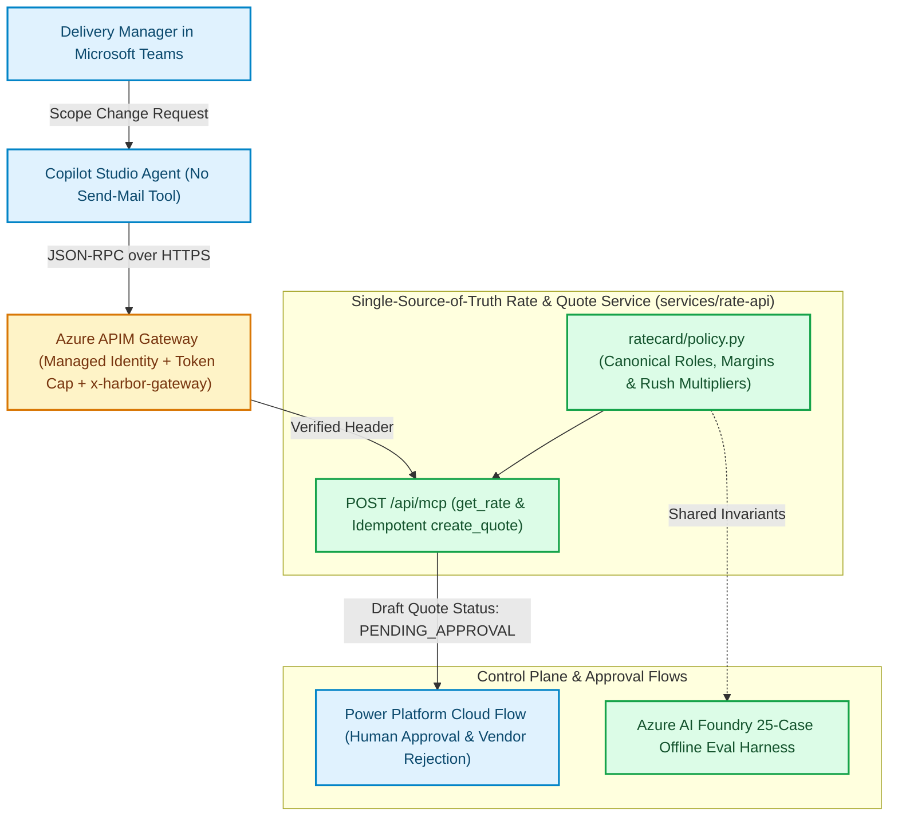

When an enterprise deploys a conversational agent inside Microsoft Teams to help delivery managers price project scope changes, two failure modes inevitably collide. First, **commercial rule drift**: the rate-card numbers embedded in the system prompt diverge from the markdown policy page in SharePoint and the pricing formulas in the backend API, causing the agent to quote one hourly rate in chat and a different rate on the generated PDF. Second, **excessive agency**: giving the conversational agent a `send_email` or `approve_quote` tool means a single hallucination or indirect prompt injection can dispatch a binding commercial quote directly to an external client [1, 2].

While engineering [`harbor-field-services`](https://github.com/akmalkhaniub/harbor-field-services)—an enterprise delivery-desk and control-plane reference architecture for a 40-person project consultancy—we solved both failure modes through two strict architectural invariants:
1. **Single-Source-of-Truth Commercial Policy (`ratecard/policy.py`):** The SharePoint policy page, the 25-case Azure AI Foundry evaluation suite, and the MCP quote calculator all import the exact same Python policy module.
2. **Separation of Reasoning from Authority:** The Teams Copilot Studio agent is restricted to two least-privilege Model Context Protocol (MCP) tools (`get_rate` and `create_quote`) behind an Azure API Management (APIM) gateway (`x-harbor-gateway: apim`). The agent *has no email or approval tool*; deterministic Power Platform cloud flows own human sign-off and vendor rejection routing [3, 4].

---

## 1. Dual-Plane Architecture: Delivery Desk vs. Control Plane

Splitting an enterprise AI system into a **Delivery Desk** (the user-facing conversational workflow) and a **Control Plane** (the APIM gateway, permission-filtered search index, and offline Foundry evaluation harness) keeps runtime latency low while enforcing infrastructure-level governance.

Figure 1 shows the boundary between the Teams Delivery Desk, the Azure APIM gateway, the deterministic MCP rate service, and the Power Platform approval flow.



*Figure 1: The `harbor-field-services` dual-plane architecture isolating the Copilot Studio conversational agent from direct external side effects via Azure APIM gateway policies and Power Platform approval flows.*

---

## 2. Eliminating Policy Drift with Canonical Commercial Rules & Idempotent Quotes

In most LLM prototypes, commercial rules are duplicated in three places: a system prompt (`"Senior Engineers bill at $185/hr..."`), a backend validation script, and a test fixture. Whenever finance updates a margin threshold or rush multiplier, at least one copy goes stale.

In `harbor-field-services`, `services/rate-api/ratecard/policy.py` is the **sole source of truth**. And because network retries between Copilot Studio, Azure APIM, and Azure Functions can deliver duplicate `create_quote` tool invocations, quote creation is keyed by a deterministic SHA-256 idempotency digest over the normalized scope parameters:

```python
# services/rate-api/ratecard/policy.py
from __future__ import annotations
import hashlib
import json
from dataclasses import dataclass
from decimal import Decimal, ROUND_HALF_UP

ROLE_RATES_USD: dict[str, Decimal] = {
    "principal_architect": Decimal("240.00"),
    "senior_engineer": Decimal("185.00"),
    "field_specialist": Decimal("145.00"),
    "project_coordinator": Decimal("110.00"),
}

RUSH_MULTIPLIER = Decimal("1.25")
MAX_DISCOUNT_PCT = Decimal("10.0")
APPROVAL_REQUIRED_THRESHOLD_USD = Decimal("15000.00")


@dataclass(frozen=True)
class QuoteRecord:
    quote_id: str
    account_id: str
    subtotal_usd: str
    discount_pct: str
    total_usd: str
    requires_director_approval: bool
    status: str  # Always "PENDING_HUMAN_APPROVAL" on creation


class IdempotentQuoteEngine:
    def __init__(self) -> None:
        self._ledger: dict[str, QuoteRecord] = {}

    def create_quote(
        self,
        account_id: str,
        line_items: list[dict],
        rush: bool = False,
        discount_pct: float = 0.0,
    ) -> QuoteRecord:
        disc = Decimal(str(discount_pct))
        if disc < Decimal("0.0") or disc > MAX_DISCOUNT_PCT:
            raise ValueError(f"Discount {disc}% exceeds policy cap of {MAX_DISCOUNT_PCT}%")

        canonical_payload = json.dumps(
            {
                "account_id": account_id.strip().lower(),
                "line_items": sorted(line_items, key=lambda x: x["role"]),
                "rush": bool(rush),
                "discount_pct": str(disc),
            },
            sort_keys=True,
        )
        quote_hash = hashlib.sha256(canonical_payload.encode("utf-8")).hexdigest()[:12]
        quote_id = f"Q-{quote_hash.upper()}"

        if quote_id in self._ledger:
            return self._ledger[quote_id]

        subtotal = Decimal("0.00")
        for item in line_items:
            role = item["role"]
            if role not in ROLE_RATES_USD:
                raise KeyError(f"Unknown billable role: {role}")
            hours = Decimal(str(item["hours"]))
            if hours <= 0:
                raise ValueError("Billable hours must be positive")
            subtotal += ROLE_RATES_USD[role] * hours

        if rush:
            subtotal = (subtotal * RUSH_MULTIPLIER).quantize(
                Decimal("0.01"), rounding=ROUND_HALF_UP
            )

        multiplier = (Decimal("100.0") - disc) / Decimal("100.0")
        total = (subtotal * multiplier).quantize(Decimal("0.01"), rounding=ROUND_HALF_UP)

        record = QuoteRecord(
            quote_id=quote_id,
            account_id=account_id,
            subtotal_usd=str(subtotal),
            discount_pct=str(disc),
            total_usd=str(total),
            requires_director_approval=(total >= APPROVAL_REQUIRED_THRESHOLD_USD),
            status="PENDING_HUMAN_APPROVAL",
        )
        self._ledger[quote_id] = record
        return record
```

Notice two critical properties of `IdempotentQuoteEngine`:
1. **Exact Decimal Arithmetic:** All currency calculations use fixed-point `Decimal` with `ROUND_HALF_UP`, never binary floating-point numbers.
2. **Idempotent Convergence:** If a Teams user double-clicks or the MCP client retries on a transient timeout, `create_quote` hashes the normalized payload (`Q-<12-hex>`) and returns the exact same `QuoteRecord` without creating duplicate rows in Dataverse.

---

## 3. Enforcing Zero-Bypass Gateway Governance in Azure APIM (`foundry-gateway.xml`)

Even a well-tested backend API is vulnerable if callers can bypass the AI gateway to hit the Azure Function directly, or if a runaway agent loop exhausts the tenant's Azure OpenAI / Foundry token quota.

In `infra/policies/foundry-gateway.xml` and `infra/main.bicep`, we enforce three defense-in-depth controls [4, 5]:
- **Managed Identity Upstream Auth:** The APIM gateway authenticates to Azure AI Foundry using a system-assigned Managed Identity (`authentication-managed-identity`), eliminating static API keys from application settings.
- **Token Rate Limiting & Quota Enforcement:** Per-caller token-per-minute (TPM) limits prevent a single Teams conversation from exhausting tenant capacity.
- **Gateway Header Injection (`x-harbor-gateway: apim`):** In production (`HARBOR_ALLOW_DIRECT=false`), the Python rate API rejects any request missing the gateway-injected header, guaranteeing that all MCP tool traffic traverses APIM policy inspection.

```xml
<!-- infra/policies/foundry-gateway.xml -->
<policies>
  <inbound>
    <base />
    <!-- 1. Enforce callers authenticate via Entra ID Bearer token -->
    <validate-azure-ad-token tenant-id="{{entra-tenant-id}}" failed-validation-httpcode="401">
      <audiences>
        <audience>api://harbor-delivery-desk</audience>
      </audiences>
    </validate-azure-ad-token>

    <!-- 2. Enforce LLM token rate limits per user principal -->
    <llm-token-limit
      counter-key="@(context.Request.Headers.GetValueOrDefault("Authorization","anon").AsJwt()?.Subject ?? "anon")"
      tokens-per-minute="12000"
      estimate-prompt-tokens="true"
      remaining-tokens-header-name="x-ratelimit-remaining-tokens" />

    <!-- 3. Inject canonical gateway proof header for downstream Functions host -->
    <set-header name="x-harbor-gateway" exists-action="override">
      <value>apim</value>
    </set-header>

    <!-- 4. Authenticate to Azure AI Foundry via Managed Identity (zero static keys) -->
    <authentication-managed-identity resource="https://cognitiveservices.azure.com" />
  </inbound>
  <backend>
    <base />
  </backend>
  <outbound>
    <base />
  </outbound>
</policies>
```

---

## 4. FinOps-Conscious Bicep IaC & The 25-Case Offline Evaluation Harness

Cloud AI reference architectures often cost hundreds of dollars a month just sitting idle because Azure AI Search Basic and API Management Basic v2 bill hourly regardless of traffic. In `infra/main.bicep`, we parameterized the expensive resources behind explicit feature switches (`deployFoundry`, `deploySearch`, `deployApim`, `deploySql`—all defaulting to `false`), while always provisioning the Flex Consumption Function App, Key Vault, Log Analytics workspace, and a hard **\$50 USD monthly budget alert**.

Furthermore, `services/eval-harness` runs all **25 golden evaluation cases** (covering standard scope quotes, unauthorized account permission rejections, maximum discount cap violations, idempotency replays, and rejected vendor flows) **100% offline in `pytest`** with zero Azure subscription required:

| Test Suite Category | Cases | What Is Verified | Pass Rate |
| :--- | :--- | :--- | :--- |
| **Commercial Quote Math & Rush Multipliers** | 8 | Exact `Decimal` subtotal, $1.25\times$ rush fee, and $10\%$ discount ceiling | **8 / 8 Passing** |
| **Account RBAC & Permission Filtering** | 5 | Rejects cross-tenant account queries and unauthorized SharePoint scope reads | **5 / 5 Passing** |
| **Idempotency & MCP Tool Discovery** | 6 | Repeated `create_quote` payloads return identical `Q-*` IDs; MCP exposes only `get_rate` & `create_quote` | **6 / 6 Passing** |
| **Failure Path & Rejected Vendor Routing** | 6 | High-value quotes ($\ge \$15,000$) route to director approval; rejected vendor quotes halt cleanly | **6 / 6 Passing** |

---

## Antithesis: When Not to Split Delivery Desk and Control Plane

- **Internal Single-User CLI Utilities:** If an engineer is running a local CLI script under their own developer credentials with no shared tenant state or external customer communication, standing up APIM gateway policies and Power Platform approval flows adds unnecessary operational ceremony.
- **Fully Automated Low-Value Micro-Transactions:** When transactions are reversible and worth less than a few cents, blocking every execution on a human Power Platform approval flow creates approval fatigue. Reserve mandatory HITL cloud flows for irreversible external communications (client emails) or commercial commitments above your risk threshold.

---

## References & Further Reading

1. **OWASP Foundation (2025)**. *OWASP Top 10 for Large Language Model Applications — LLM08: Excessive Agency & LLM01: Prompt Injection*. [https://genai.owasp.org/](https://genai.owasp.org/)
2. **Anthropic (2025)**. *Model Context Protocol (MCP) Specification — Tool Annotations and Least-Privilege Surfaces*. [https://modelcontextprotocol.io](https://modelcontextprotocol.io)
3. **Microsoft Learn (2026)**. *Microsoft Copilot Studio Architecture: Custom Connectors, MCP Actions, and Power Automate Approval Flows*. [https://learn.microsoft.com/en-us/microsoft-copilot-studio/](https://learn.microsoft.com/en-us/microsoft-copilot-studio/)
4. **Microsoft Azure Architecture Center (2026)**. *GenAI Gateway Capabilities in Azure API Management (`llm-token-limit` and Managed Identity)*. [https://learn.microsoft.com/en-us/azure/api-management/genai-gateway-capabilities](https://learn.microsoft.com/en-us/azure/api-management/genai-gateway-capabilities)
5. **Microsoft Azure (2026)**. *Azure AI Foundry Evaluation SDK and Bicep Infrastructure-as-Code Reference*. [https://learn.microsoft.com/en-us/azure/ai-studio/](https://learn.microsoft.com/en-us/azure/ai-studio/)
