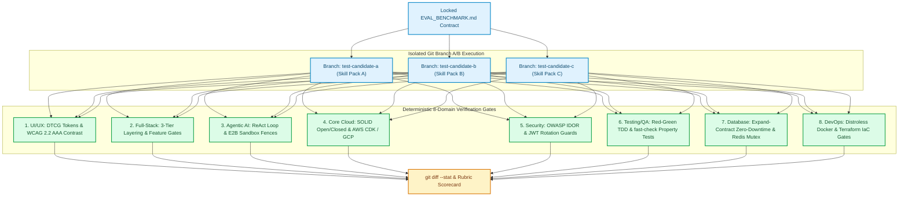

Most evaluations of AI coding agents measure the wrong thing. Popular leaderboards test whether a model can synthesize a standalone 40-line Python function to pass a LeetCode-style unit test [1]. Yet in production software engineering, agents rarely fail on isolated syntax. They fail on **systemic architectural invariants**: generating a SaaS checkout endpoint with an Insecure Direct Object Reference (IDOR) vulnerability, writing a database migration that locks a 50-million-row PostgreSQL table during peak traffic, or shipping a UI component that breaks WCAG 2.2 AAA contrast in dark mode [2, 3].

Over the past year, teams have turned to modular **Agent Skills** (`SKILL.md` instruction packs, `.codex/skills`, and `.cursorrules`) to encode domain expertise. But how do you know whether installing a new UI/UX, Security, or Database skill pack actually improves code quality—or silently degrades another invariant?

To answer that question quantitatively, we built [`skills-eval-lab`](https://github.com/akmalkhaniub/skills-eval-lab) (*Skills Evaluation Lab*), an **8-domain multi-project A/B benchmarking testbed** evaluating 24 candidate agent skill packs across the entire software development lifecycle, alongside [`steerability-challenge-2026`](https://github.com/akmalkhaniub/steerability-challenge-2026) (*HonestSteer*, our NeurIPS 2026 `.spipe` activation steering pipeline) and [`agenthon-quant-ai`](https://github.com/akmalkhaniub/agenthon-quant-ai) (*VeriQuant AI*, our NeurIPS 2026 leak-proof G0–G3 quantitative agent).

---

## 1. The 8-Domain SDLC Evaluation Matrix

Instead of relying on subjective "LLM-as-a-Judge" prose ratings—which suffer from position bias, verbosity bias, and self-preference [4]—`skills-eval-lab` partitions the software engineering lifecycle into **eight isolated repository sandboxes**. Each sandbox contains a locked `EVAL_BENCHMARK.md` specification and a deterministic verification suite that grades candidate agent implementations on hard compile, security, and runtime invariants.



*Figure 1: The `skills-eval-lab` Git-branch A/B evaluation workflow benchmarking 24 candidate skill packs across 8 deterministic SDLC verification gates.*

Table 1 summarizes the eight evaluation domains, the candidate skill packs tested in each sandbox, and the deterministic failure mode each benchmark is designed to catch:

| Sandbox Directory | Engineering Domain | Candidate Skills Benchmarked | Primary Failure Mode Caught by Gate |
| :--- | :--- | :--- | :--- |
| **`eval-ui-ux/`** | Design Systems & A11y | `plugin87-ux-ui`, `nextlevel-ui-ux-promax`, `jakubkrehel-accessibility` | Hardcoded hex colors instead of W3C DTCG tokens; dark-mode contrast $< 7.0:1$ (WCAG AAA) |
| **`eval-fullstack/`** | SaaS Architecture | `minimax-fullstack-dev`, `addyosmani-engineering`, `bulletproof-architecture` | Business logic leaked into HTTP controllers; missing tenant subscription entitlement gates |
| **`eval-agentic-ai/`** | Autonomous Agents | `voltagent-workflow`, `sickn33-guardrails`, `e2b-sandbox-tools` | Unbounded ReAct loops without max-step circuit breakers; unsandboxed code execution |
| **`eval-core-engineering/`** | SOLID & Cloud IaC | `solid-clean-code`, `aws-cdk-serverless`, `gcp-cloud-architecture` | `if/elif` channel sprawl violating Open/Closed Principle; overly permissive IAM wildcards (`*`) |
| **`eval-security-audit/`** | AppSec & Prompt Defense | `owasp-secure-coding`, `auth-tokens-guard`, `agent-prompt-defense` | Cross-tenant IDOR on `GET /documents/:id`; missing refresh-token reuse detection |
| **`eval-testing-qa/`** | Property TDD & E2E | `tdd-vitest-jest`, `playwright-e2e`, `mutation-property-testing` | Example-only tests that miss floating-point discount edge cases caught by `fast-check` |
| **`eval-database-performance/`** | Storage & Caching | `db-schema-migrations`, `query-optimization-indexing`, `cache-redis-patterns` | Table-locking `ALTER TABLE ... NOT NULL` migrations; cache stampedes under concurrent misses |
| **`eval-devops-cicd/`** | Containers & Pipelines | `docker-container-hardening`, `github-actions-workflows`, `terraform-iac-platform` | Running containers as `root` (UID 0); unpinned GitHub Action tags vulnerable to supply-chain attacks |

---

## 2. Case Study 1: Catching Subtle Edge Cases with Property-Based Testing (`eval-testing-qa`)

When an AI coding agent is asked to write unit tests for a tiered e-commerce checkout and discount engine, a standard prompt produces 3 or 4 happy-path `expect(calculateTotal(...)).toBe(...)` assertions. Those example-based tests pass $100\%$ of the time even when the underlying implementation contains a stacked-coupon rounding bug that allows a cart total to go negative or exceed the maximum promotional cap.

In `eval-testing-qa`, the verification gate requires **property-based testing** (`fast-check` / Hypothesis) verifying mathematical invariants across thousands of randomly generated cart permutations [5]:

```typescript
// eval-testing-qa/tests/checkout.property.spec.ts
import { describe, it, expect } from "vitest";
import fc from "fast-check";
import { computeCartSettlement, CartItem, Coupon } from "../src/checkout";

describe("Checkout & Discount Engine — Property Invariants", () => {
  const itemArb: fc.Arbitrary<CartItem> = fc.record({
    sku: fc.stringMatching(/^[A-Z]{3}-\d{4}$/),
    unitPriceCents: fc.integer({ min: 1, max: 500_000 }),
    quantity: fc.integer({ min: 1, max: 100 }),
  });

  const couponArb: fc.Arbitrary<Coupon> = fc.record({
    code: fc.constantFrom("WELCOME10", "VIP25", "BUNDLE15", "FLASH50"),
    percentOff: fc.integer({ min: 5, max: 50 }),
    maxDiscountCents: fc.integer({ min: 500, max: 25_000 }),
  });

  it("enforces non-negativity, promotional ceiling, and integer cent conservation", () => {
    fc.assert(
      fc.property(
        fc.array(itemArb, { minLength: 1, maxLength: 25 }),
        fc.array(couponArb, { minLength: 0, maxLength: 4 }),
        fc.integer({ min: 0, max: 1500 }), // tax basis points (0% to 15%)
        (items, coupons, taxBps) => {
          const grossCents = items.reduce(
            (acc, item) => acc + item.unitPriceCents * item.quantity,
            0
          );
          const settlement = computeCartSettlement(items, coupons, taxBps);

          // Invariant 1: Final total is an exact integer and never negative
          expect(Number.isInteger(settlement.finalTotalCents)).toBe(true);
          expect(settlement.finalTotalCents).toBeGreaterThanOrEqual(0);

          // Invariant 2: Stacked discounts never exceed 60% of gross subtotal
          const maxAllowedDiscount = Math.floor(grossCents * 0.60);
          expect(settlement.appliedDiscountCents).toBeLessThanOrEqual(maxAllowedDiscount);

          // Invariant 3: Conservation identity holds to the exact cent
          expect(
            grossCents - settlement.appliedDiscountCents + settlement.taxCents
          ).toBe(settlement.finalTotalCents);
        }
      ),
      { numRuns: 2000 }
    );
  });
});
```

Across our A/B runs, agents guided by `mutation-property-testing` uncovered stacked-coupon boundary violations within 40 `fast-check` shrinks that `tdd-vitest-jest` (example-only) completely missed.

---

## 3. Case Study 2: Preventing Cache Stampedes & Locking Migrations (`eval-database-performance`)

In `eval-database-performance`, candidate skills are tasked with scaling a high-throughput tenant activity feed backed by PostgreSQL and Redis. Naive agent completions fail two production gates:
1. **Locking Schema Migrations:** Running `ALTER TABLE activity_events ADD COLUMN payload_version INT NOT NULL DEFAULT 1` on legacy engines or adding a synchronous index without `CREATE INDEX CONCURRENTLY` blocks concurrent writes. The `db-schema-migrations` skill enforces the **3-phase Expand-Contract pattern** (Expand nullable column + trigger $\rightarrow$ Backfill in batched chunks $\rightarrow$ Contract `NOT NULL` constraint via `NOT VALID` + `VALIDATE CONSTRAINT`).
2. **Thundering Herd / Cache Stampede:** When a hot tenant's feed cache key expires under $5,000$ RPS, all $5,000$ worker coroutines miss Redis simultaneously and hammer PostgreSQL. The `cache-redis-patterns` skill enforces **Singleflight / Distributed Mutex Lease + Probabilistic Early Expiration (XFetch)** [6]:

```python
# eval-database-performance/src/cache_singleflight.py
import asyncio
import math
import random
import time
from typing import Any, Awaitable, Callable


class StampedeSafeCache:
    """
    Combines per-key asyncio singleflight coalescing with XFetch probabilistic
    early recomputation (Vattani et al., VLDB 2015) to prevent cache stampedes.
    """

    def __init__(self, beta: float = 1.0) -> None:
        self._store: dict[str, tuple[Any, float, float]] = {}  # key -> (val, delta, expiry)
        self._inflight: dict[str, asyncio.Future[Any]] = {}
        self._beta = beta

    async def get_or_compute(
        self,
        key: str,
        ttl_seconds: float,
        loader: Callable[[], Awaitable[Any]],
    ) -> Any:
        now = time.monotonic()
        entry = self._store.get(key)

        if entry is not None:
            val, delta, expiry = entry
            # XFetch early recomputation check: now - delta * beta * ln(rand()) >= expiry
            xfetch_trigger = now - (delta * self._beta * math.log(max(random.random(), 1e-9)))
            if xfetch_trigger < expiry:
                return val

        # Coalesce concurrent cache misses onto a single in-flight database query
        if key in self._inflight:
            return await self._inflight[key]

        loop = asyncio.get_running_loop()
        fut: asyncio.Future[Any] = loop.create_future()
        self._inflight[key] = fut
        try:
            t0 = time.monotonic()
            fresh_val = await loader()
            compute_delta = time.monotonic() - t0
            self._store[key] = (fresh_val, compute_delta, time.monotonic() + ttl_seconds)
            fut.set_result(fresh_val)
            return fresh_val
        except Exception as exc:
            fut.set_exception(exc)
            raise
        finally:
            self._inflight.pop(key, None)
```

---

## 4. Beyond Prompt Skills: Inference-Time Steering (`HonestSteer`) & Anti-Leakage Gates (`VeriQuant AI`)

Prompt-level skills (`SKILL.md`) are necessary but not sufficient when models face adversarial sycophancy pressure or temporal data leakage:

1. **Inference-Time Activation Steering ([`steerability-challenge-2026`](https://github.com/akmalkhaniub/steerability-challenge-2026)):** Built for the **IBM Research / NeurIPS 2026 Steerability Challenge**, **HonestSteer** implements a standardized `.spipe` activation steering pipeline [7]. Rather than relying solely on system prompts—which can be diluted over long contexts—HonestSteer hooks into intermediate transformer residual streams during forward passes, projects out sycophantic/dishonest activation components along a calibrated honesty direction vector $\vec{v}_{\text{honest}}$, and clamps perturbation norms via cosine-similarity gating so MMLU and GSM8K reasoning remain intact.
2. **Cheat-Resistant Temporal Audit Gates ([`agenthon-quant-ai`](https://github.com/akmalkhaniub/agenthon-quant-ai)):** Built for the **NeurIPS 2026 Quantitative Agenthon (SQA & CEWIT)**, **VeriQuant AI** enforces four compile-time and runtime audit gates (`G0` Schema, `G1` Strict `t-1` Temporal Leakage Prevention, `G2` Turnover Bounds, `G3` Deterministic Docker Reproducibility). In Gate `G1`, the test harness runs the alpha generator up to timestamp $T$, appends synthetic adversarial price spikes at $T+1 \dots T+5$, and verifies bit-for-bit identity of all portfolio weights at $\le T$—mathematically guaranteeing zero lookahead bias.

---

## Antithesis: When Not to Use Full 8-Domain Branch Benchmarking

- **Single-File Formatting or Lint Rules:** If a rule can be enforced deterministically by a sub-millisecond AST linter (`ruff`, `biome`, `eslint`, or `tsc --noEmit`), do not write a prose `SKILL.md` instruction for it. Put it in the pre-commit hook and CI linter directly.
- **Throwaway Exploratory Prototypes:** When exploring an API in a scratch notebook with a 2-hour lifespan, running an 8-domain security, accessibility, and zero-downtime migration harness is unnecessary overhead. Use `skills-eval-lab` when curating and locking the canonical skill packs that your engineering organization relies on across production repositories.

---

## References & Further Reading

1. **Jimenez, C. E., et al. (2024)**. *SWE-bench: Can Language Models Resolve Real-World GitHub Issues?*. International Conference on Learning Representations (ICLR 2024). [https://arxiv.org/abs/2310.06770](https://arxiv.org/abs/2310.06770)
2. **OWASP Foundation (2025)**. *OWASP API Security Top 10 — API1:2023 Broken Object Level Authorization (BOLA / IDOR)*. [https://owasp.org/API-Security/](https://owasp.org/API-Security/)
3. **W3C Design Tokens Community Group (2025)**. *Design Tokens Format Module (DTCG Specification)*. [https://tr.designtokens.org/format/](https://tr.designtokens.org/format/)
4. **Zheng, L., et al. (2023)**. *Judging LLM-as-a-Judge with MT-Bench and Chatbot Arena*. Advances in Neural Information Processing Systems (NeurIPS 2023). [https://arxiv.org/abs/2306.05685](https://arxiv.org/abs/2306.05685)
5. **Claessen, K., & Hughes, J. (2000)**. *QuickCheck: A Lightweight Tool for Random Testing of Haskell Programs*. ACM SIGPLAN Notices, 35(9), 268–279.
6. **Vattani, A., Chierichetti, F., & Lowenstein, K. (2015)**. *Optimal Probabilistic Cache Stampede Prevention (XFetch)*. Proceedings of the VLDB Endowment, 8(8), 886–897.
7. **Zou, A., et al. (2023)**. *Representation Engineering: A Top-Down Approach to AI Transparency*. arXiv:2310.01405. [https://arxiv.org/abs/2310.01405](https://arxiv.org/abs/2310.01405)
