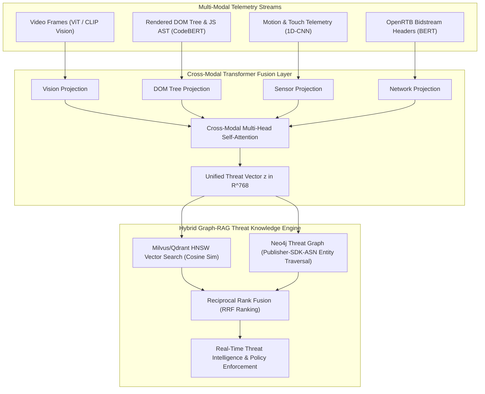

# Cross-Modal Representation Learning & Hybrid Graph-RAG for Ad Creative Forensics: Fusing Video, DOM Trees, and Sensor Telemetry

> [!NOTE]
> **📖 Research & Systems Overview**
> Malicious ad creatives and cloaked exploits cost the digital advertising ecosystem tens of billions of dollars annually. Threat actors present benign static banners to automated ad review scanners while deploying hidden video rendering, zero-pixel iframes, auto-redirecting JavaScript, and biometric sensor spoofing to real users. This deep-dive architectural guide explores how to build a unified **Cross-Modal Representation Learning** model and a petabyte-scale **Hybrid Graph-RAG** system that fuses video frames, rendered DOM trees, and device motion telemetry into high-dimensional vector spaces for real-time fraud detection.

---

## 1. The Anatomy of Modern Ad Creative Cloaking

Ad cloaking operates across disjoint operational modalities:

* **Visual Modality**: A $300\times250$ banner displays a legitimate consumer brand.
* **Structural DOM Modality**: Hidden beneath the canvas element sits a stacked $1\times1$ pixel iframe loading a background video player that cycles 50 fraudulent impressions per minute.
* **Behavioral / Sensor Modality**: Touch events occur with zero accelerometer fluctuation and deterministic $0.00\text{ms}$ touch durations, revealing simulated bot clicks.
* **Network Modality**: Delayed redirects trigger only when specific user-agent entropy and IP geographic criteria are satisfied.

Unimodal classification models fail because each single stream appears benign in isolation. Detection requires a **Joint Cross-Modal Embedding Space** where disparate modalities project into a shared metric latent vector $\mathbf{z} \in \mathbb{R}^D$.



---

## 2. Cross-Modal Representation Learning: Joint Metric Optimization

We formulate cross-modal representation learning using a multi-modal contrastive objective. For an ad event $i$, we acquire visual features $\mathbf{x}_i^{(v)}$, DOM tree representations $\mathbf{x}_i^{(d)}$, and sensor time-series $\mathbf{x}_i^{(s)}$.

Each modality is mapped through an encoder $f_m(\cdot)$ followed by a learned linear projection $g_m(\cdot)$:

$$\mathbf{z}_i^{(m)} = \frac{g_m(f_m(\mathbf{x}_i^{(m)}))}{\|g_m(f_m(\mathbf{x}_i^{(m)}))\|_2}, \quad m \in \{v, d, s\}$$

### Multi-Modal InfoNCE Loss Function

The joint contrastive loss maximizes agreement between modalities of the same genuine ad while separating mismatched or cloaked instances:

$$\mathcal{L}_{\text{InfoNCE}}(m_1, m_2) = -\frac{1}{B} \sum_{i=1}^B \log \frac{\exp\left( \langle \mathbf{z}_i^{(m_1)}, \mathbf{z}_i^{(m_2)} \rangle / \tau \right)}{\sum_{j=1}^B \exp\left( \langle \mathbf{z}_i^{(m_1)}, \mathbf{z}_j^{(m_2)} \rangle / \tau \right)}$$

Where $\tau$ is a learnable temperature parameter. When an ad creative's visual banner does not align with its hidden DOM hierarchy, the cross-modal cosine similarity $\langle \mathbf{z}_i^{(v)}, \mathbf{z}_i^{(d)} \rangle$ collapses below the benign distribution threshold, triggering a high-priority anomaly alert.

---

## 3. High-Performance Hybrid Graph-RAG Architecture

Once a unified vector is produced, the system must cross-reference it against billions of historical ad campaigns and threat entities within sub-50 milliseconds.

### The Limitation of Vector-Only RAG
Standard vector databases retrieve items based strictly on semantic similarity. However, advanced ad fraud rings frequently repurpose old visual templates with newly registered domain infrastructures. Pure vector search misses the relationship between the new domain, the underlying SDK signature, and the associated hosting ASN.

### The Hybrid Solution: Vector + Knowledge Graph Fusion
We deploy a dual-engine architecture:
1. **Vector Index (Milvus / Qdrant)**: HNSW index with Product Quantization (PQ) for millisecond nearest-neighbor retrieval over billion-scale creative embeddings.
2. **Knowledge Graph (Neo4j)**: Property graph linking `AppBundle -> SDK_Hash -> Domain -> ASN -> AdNetwork`.

```
Algorithm 1: Reciprocal Rank Fusion (RRF) for Threat Intelligence
Input: Query vector z_q, Graph seed nodes G_seeds
1. D_vec = HNSW_Search(z_q, TopK=50)
2. D_graph = Cypher_PPR_Traversal(G_seeds, MaxDepth=3, TopK=50)
3. For each document d in (D_vec ∪ D_graph):
     RRF_Score(d) = (1 / (60 + Rank_vec(d))) + (1 / (60 + Rank_graph(d)))
4. Return Top 10 documents by RRF_Score
```

---

## 4. Production Implementation: PyTorch Cross-Modal Fusion & RRF Engine

Here is a production-grade implementation of the Cross-Modal Feature Projector and the Hybrid Retrieval Ranker.

```python
import torch
import torch.nn as nn
import torch.nn.functional as F
from typing import List, Dict, Tuple

class CrossModalAdFusion(nn.Module):
    """
    Cross-modal attention fusion layer mapping Visual, DOM, and Sensor
    features into a shared 768-dimensional forensic embedding.
    """
    def __init__(self, d_vis=512, d_dom=768, d_sensor=128, d_out=768):
        super().__init__()
        # Modal Projection Heads
        self.proj_vis = nn.Linear(d_vis, d_out)
        self.proj_dom = nn.Linear(d_dom, d_out)
        self.proj_sensor = nn.Linear(d_sensor, d_out)
        
        # Cross-Attention Transformer Layer
        encoder_layer = nn.TransformerEncoderLayer(
            d_model=d_out,
            nhead=8,
            dim_feedforward=2048,
            dropout=0.1,
            activation="gelu",
            batch_first=True
        )
        self.cross_transformer = nn.TransformerEncoder(encoder_layer, num_layers=2)
        self.pool = nn.AdaptiveAvgPool1d(1)

    def forward(
        self,
        vis_emb: torch.Tensor,     # [B, 512]
        dom_emb: torch.Tensor,     # [B, 768]
        sensor_emb: torch.Tensor   # [B, 128]
    ) -> torch.Tensor:
        b_size = vis_emb.size(0)
        
        # Project into common latent dimension
        h_v = self.proj_vis(vis_emb).unsqueeze(1)       # [B, 1, 768]
        h_d = self.proj_dom(dom_emb).unsqueeze(1)       # [B, 1, 768]
        h_s = self.proj_sensor(sensor_emb).unsqueeze(1) # [B, 1, 768]
        
        # Token sequence: [Visual, DOM, Sensor]
        seq = torch.cat([h_v, h_d, h_s], dim=1)         # [B, 3, 768]
        
        # Multi-modal context attention
        fused_seq = self.cross_transformer(seq)         # [B, 3, 768]
        
        # Global mean pooling and L2 normalization
        pooled = fused_seq.mean(dim=1)                  # [B, 768]
        return F.normalize(pooled, p=2, dim=-1)


class HybridRRFRetriever:
    """
    Merges dense vector search results with graph-traversal threat intelligence
    via Reciprocal Rank Fusion (RRF).
    """
    def __init__(self, rrf_k: int = 60):
        self.rrf_k = rrf_k

    def fuse(
        self,
        vector_results: List[Tuple[str, float]],  # List of (doc_id, distance)
        graph_results: List[Tuple[str, float]]    # List of (doc_id, graph_score)
    ) -> List[Tuple[str, float]]:
        scores: Dict[str, float] = {}

        # 1. Score dense vector rank
        for rank, (doc_id, _) in enumerate(vector_results, start=1):
            scores[doc_id] = scores.get(doc_id, 0.0) + (1.0 / (self.rrf_k + rank))

        # 2. Score knowledge graph proximity rank
        for rank, (doc_id, _) in enumerate(graph_results, start=1):
            scores[doc_id] = scores.get(doc_id, 0.0) + (1.0 / (self.rrf_k + rank))

        # Sort descending by fused RRF score
        ranked = sorted(scores.items(), key=lambda x: x[1], reverse=True)
        return ranked
```

---

## 5. Chunking Strategies for Hierarchical DOM and Network PCAPs

One critical failure point in RAG systems applied to cybersecurity is naive fixed-length token chunking. Splitting an HTML ad container or PCAP stream at an arbitrary 512-token boundary breaks syntactic integrity:

* **AST-Aware DOM Chunking**: Rather than chunking characters, parse the DOM into an Abstract Syntax Tree (AST). Retain the root element down to the parent iframe container, creating semantic chunks bounded by functional boundaries (`<iframe src="...">`, `<script>`, `<canvas>`).
* **Session-Boundary PCAP Slicing**: Group network packets by bidirectional flow tuples `(src_ip, dst_ip, src_port, dst_port, protocol)` within a sliding 5-second session window.

```
| Chunking Modality | Naive Token Splitting (Broken) | Context-Aware AST / Flow Slicing (Optimized) |
|-------------------|--------------------------------|----------------------------------------------|
| DOM Tree HTML     | Cuts inline script payload     | Emits isolated DOM subtrees with parent path  |
| Sensor Telemetry  | Splits accelerometer axis mid-gesture | Emits full gesture window (touch down -> up) |
| Network Streams   | Fragments TCP packets          | Retains TLS handshake + HTTP header block    |
```

---

## 6. Key Takeaways & Operational Impact

1. **Unimodal Scanners Are Obsolete**: Threat actors intentionally design each individual stream to appear harmless. Multi-modal attention is required to detect semantic mismatch between appearance and behavior.
2. **Graph-RAG Outperforms Flat Vector DBs**: Ad fraud is fundamentally relational. Combining HNSW vector retrieval with Neo4j graph entity hops via Reciprocal Rank Fusion eliminates the blind spots of vector-only search.
3. **Sub-50ms SLA Execution**: By projecting all modalities down to normalized 768-D vectors and using product quantization, billions of historical threat signatures can be queried in real time within ad auction bidding pipelines.
