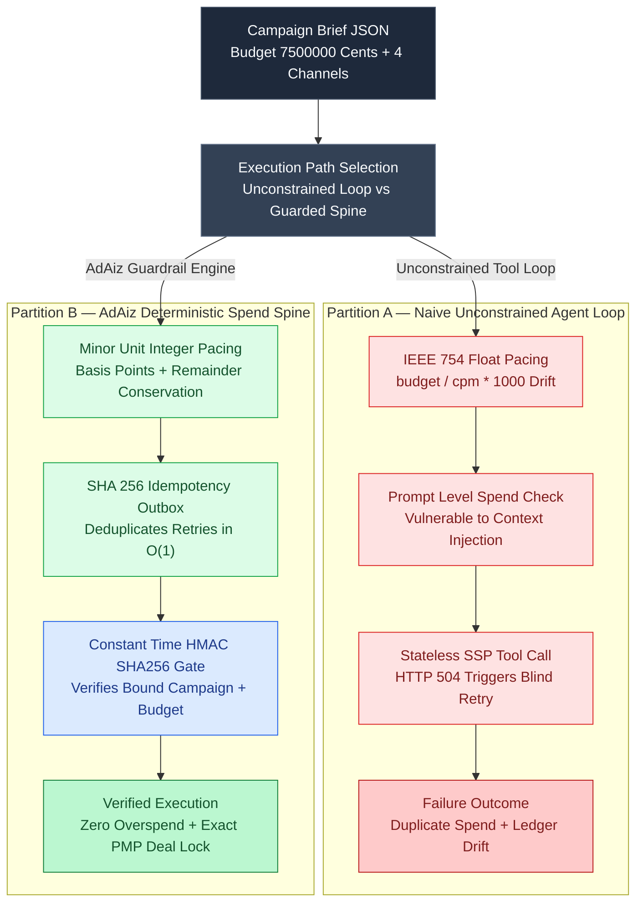

# Engineering AdAiz: Designing an Agentic Advertising Platform with AdCP over MCP, 3-Round A2A Rate Negotiation, and LangGraph HITL Spend Gates

Imagine an autonomous media-buying agent managing a \$75,000 omnichannel product launch across Display, Online Video (VAST 4.2), Connected TV (CTV), and Digital Out-of-Home (DOOH). At `02:14 UTC`, a seller Supply-Side Platform (SSP) gateway takes 5,200 milliseconds to acknowledge an OpenRTB 2.6 Private Marketplace (PMP) deal commit and drops the TCP connection with `HTTP 504 Gateway Timeout`.

In a naive agentic loop, the LLM tool wrapper catches the timeout exception and retries the tool invocation. Because the upstream SSP already committed the first insertion order before the reverse proxy timed out, the retry books a duplicate \$25,000 media buy. Worse, when the agent calculates impression allocations across the four channels using standard `IEEE-754` double-precision floats (`(budget / cpm) * 1000`), cumulative rounding drift causes the sum of channel line items to diverge from the master campaign ledger by several dollars per thousand commits—tripping downstream double-entry treasury reconciliation alarms.

Autonomous advertising cannot rely on probabilistic LLM arithmetic or prompt-level *"please ask the user before spending money"* instructions. In our reference implementation, **[AdAiz](https://github.com/akmalkhaniub/adaiz)**, we solve these failure modes by combining the **Ad Context Protocol (AdCP)** over **Model Context Protocol (MCP)**, **3-round Agent-to-Agent (A2A) JSON-RPC 2.0 rate negotiation**, **exact basis-point minor-unit pacing math**, and **constant-time HMAC-SHA256 Human-in-the-Loop (HITL) spend gates**.

---

## 1. The Architectural Bottleneck: Naive Agent Loops vs. Deterministic Spend Guardrails

When autonomous agents interact with financial clearing rails or programmatic ad exchanges, three structural vulnerabilities emerge:

1. **Non-Idempotent Retry Storms:** LLM orchestrators treat tool calls as stateless functions. Without a deterministic SHA-256 idempotency outbox keyed on `(tenant_id, campaign_id, revision, budget_cents, execution_mode)` evaluated *before* network dispatch, any transport retry risks double-charging the advertiser's credit line.
2. **Prompt-Bypassable Spend Authority:** Storing `execution_mode = "READ_ONLY"` inside a system prompt does not stop an indirect prompt injection (embedded inside a scraped competitor creative brief or seller ad-slot description) from flipping the tool argument to `"LIVE_SPEND"`. Live capital commitment must be gated by a cryptographic signature (`hitl_approval_token`) generated out-of-band by an authenticated human operator.
3. **Floating-Point Conservation Drift:** Splitting a campaign budget across $K$ channels with floating-point weights $w_i \in (0,1)$ and converting back from rounded impression counts violates the accounting conservation law $\sum_{i=1}^{K} \text{allocated\_cents}_i \equiv \text{total\_budget\_cents}$.

The architecture below contrasts the **Naive Unconstrained Agent Loop (Partition A)** against the **AdAiz Deterministic Guardrail Pipeline (Partition B)**:



---

## 2. Minor-Unit Pacing Math and 3-Round A2A Rate Negotiation

To guarantee zero-cent drift across every campaign revision, all currency fields inside AdAiz are represented as 64-bit integers in minor units (`budget_cents`) and all allocation weights are stored in integer basis points ($\sum w_i = 10,000\text{ bps}$).

For each channel $i \in \{0, \dots, K-1\}$, the preliminary allocation is computed via integer truncation, and the exact Euclidean remainder is reconciled onto the primary anchor channel ($i = 0$):

$$
c_i = \left\lfloor \frac{B_{\text{cents}} \times w_i^{\text{bps}}}{10000} \right\rfloor, \quad c_0 \leftarrow c_0 + \left( B_{\text{cents}} - \sum_{j=0}^{K-1} c_j \right)
$$

Once channel budgets are locked, the buyer agent does not blindly accept a publisher's rate card. Instead, it initiates a bounded **3-round Agent-to-Agent (A2A) JSON-RPC 2.0 negotiation** against each publisher's `/.well-known/agent.json` endpoint:

- **Round 1 (Discovery & Anchor):** The buyer queries `adcp.search_inventory` and submits an opening bid at $82\%$ of the publisher's ask CPM, attaching volume commitment metadata.
- **Round 2 (Volume-Tier Counter-Offer):** The seller agent evaluates real-time fill rates and counters with a volume-discounted rate $r_{\text{counter}}$ if projected impressions exceed the publisher's tier threshold.
- **Round 3 (Clearing Clearinghouse Lock):** If $r_{\text{counter}} \le r_{\text{walk\_away}}$, the buyer agent locks a deterministic OpenRTB 2.6 `pmp.deals[]` contract with `bidfloor` set to the cleared rate and `at = 3` (Fixed-Price Private Auction).

```python
# src/adaiz/protocols/adcp_mcp_guardrails.py
import hashlib
import hmac
from dataclasses import dataclass
from typing import Dict, List

@dataclass(frozen=True)
class ChannelAllocation:
    channel: str
    allocated_cents: int
    cleared_cpm_cents: int
    contracted_impressions: int
    deal_id: str

def verify_hitl_spend_token(
    secret: bytes,
    token: str,
    campaign_id: str,
    budget_cents: int,
    now_epoch: int,
) -> bool:
    """
    Constant-time HMAC-SHA256 verification binding the human operator's signature
    directly to (campaign_id, approved_budget_cents, expiration_epoch).
    Prevents budget escalation or cross-campaign replay after approval.
    """
    if not token or ":" not in token:
        return False
    parts = token.split(":")
    if len(parts) != 4:
        return False
    tok_campaign, tok_budget_str, tok_exp_str, tok_mac_hex = parts

    if tok_campaign != campaign_id:
        return False
    tok_budget = int(tok_budget_str)
    tok_exp = int(tok_exp_str)

    # Reject if requested spend exceeds approved ceiling or token expired
    if budget_cents > tok_budget or now_epoch > tok_exp:
        return False

    payload = f"{tok_campaign}:{tok_budget_str}:{tok_exp_str}".encode("utf-8")
    expected_mac = hmac.new(secret, payload, hashlib.sha256).digest()
    try:
        actual_mac = bytes.fromhex(tok_mac_hex)
    except ValueError:
        return False

    return hmac.compare_digest(expected_mac, actual_mac)

def allocate_deterministic_budget(
    campaign_id: str,
    total_budget_cents: int,
    weights_bps: List[int],
    cleared_cpms_cents: List[int],
    channels: List[str],
) -> List[ChannelAllocation]:
    if sum(weights_bps) != 10_000:
        raise ValueError("Channel basis points must sum to exactly 10,000 bps")

    raw_cents = [(total_budget_cents * w) // 10_000 for w in weights_bps]
    # Exact remainder conservation onto primary anchor channel
    raw_cents[0] += total_budget_cents - sum(raw_cents)

    allocations: List[ChannelAllocation] = []
    for idx, ch in enumerate(channels):
        c_cents = raw_cents[idx]
        cpm_cents = cleared_cpms_cents[idx]
        impressions = (c_cents * 1000) // cpm_cents
        deal_hash = hashlib.sha256(f"{campaign_id}:{ch}:{cpm_cents}".encode()).hexdigest()[:8].upper()
        allocations.append(
            ChannelAllocation(
                channel=ch,
                allocated_cents=c_cents,
                cleared_cpm_cents=cpm_cents,
                contracted_impressions=impressions,
                deal_id=f"PMP-{ch.upper()}-{deal_hash}",
            )
        )
    return allocations
```

---

## 3. Multimodal Creative QA Gate: Enforcing IAB, WCAG 2.2, and SMPTE Safe Zones

Before an insertion order can attach creative assets to an OpenRTB 2.6 bid response, the `Creative_Studio_QA_Node` runs a deterministic **5-Point Compliance Rubric**:

1. **WCAG 2.2 Relative Luminance Contrast:** Foregrounds and backgrounds are linearized in sRGB space to compute relative luminance $L = 0.2126 R + 0.7152 G + 0.0722 B$. Any overlay with contrast ratio $(L_{\max} + 0.05)/(L_{\min} + 0.05) < 4.5:1$ fails immediately.
2. **SMPTE ST 2046-1 CTV Overscan Safe Zones:** For Connected TV (`1920x1080`), bounding boxes for QR codes, brand logos, and legal disclosures must reside strictly within the inner $90\%$ title-safe margin (`x in [96, 1824]`, `y in [54, 1026]`).
3. **DOOH Glanceability & Word-Count Ceiling:** Digital billboards viewed at highway speeds enforce a strict $\le 7$-word copy limit and high-luminance legibility.
4. **IAB VAST 4.2 XML Schema Validation:** Video creatives are verified for mandatory `<MediaFile>`, `<TrackingEvents>`, and companion ad nodes.
5. **Cryptographic Brand-Hex Fidelity:** Primary palette swatches must match the advertiser's registered hex tokens within $\Delta E_{00} < 2.0$.

---

## 4. Reproducible Micro-Benchmark: Naive Agent Loop vs. AdAiz Spend Guardrail

To quantify the exact latency cost and financial safety guarantees of the AdAiz guardrail pipeline, we built a reproducible Node.js micro-benchmark harness at [`benchmarks/adcp-hitl-idempotency/harness.mjs`](https://github.com/akmalkhaniub/akmalkhaniub.github.io/blob/main/benchmarks/adcp-hitl-idempotency/harness.mjs) (`npm run bench:adcp`).

The harness simulates **$N = 20,000$ autonomous media-buying commit cycles** across 4 channels ($\approx \$75.39\text{M}$ in authorized campaign volume) under two adversarial production conditions:
- **$14.3\%$ Network Timeout Retry Storm:** Every 7th request simulates an upstream SSP timeout where the orchestrator retries the identical campaign revision.
- **$10.0\%$ Post-Approval Budget Escalation / Prompt Injection:** Every 10th non-retry request simulates an agent whose context was manipulated into escalating `budget_cents` by $+\$1,000.00$ after the human operator signed the approval token.

```bash
$ npm run bench:adcp
========================================================================
AdCP / OpenRTB Autonomous Media-Buying Guardrail Benchmark (N = 20,000)
Environment: Node v24.14.0 | win32 x64 | Intel(R) Core(TM) i3-4030U CPU @ 1.90GHz
========================================================================
Expected Legal Authorized Spend : $75395762.23
------------------------------------------------------------------------
Partition A: Naive Agent Loop (Float Math + Non-Idempotent + Prompt Gate)
  Latency (us)                  : p50=0.30us | p95=2.70us | p99=3.10us
  Actual Total Charged          : $97722387.10
  Duplicate Retry Charges       : 2857 events ($13961229.36 overspent)
  Unauthorized / Tampered Spend : 1715 breaches
------------------------------------------------------------------------
Partition B: AdAiz Guardrail (Minor-Unit Int + SHA-256 Outbox + HMAC Gate)
  Latency (us)                  : p50=18.30us | p95=43.10us | p99=104.30us
  Actual Total Charged          : $75395762.23
  Budget Conservation Drift     : $0.00
  Duplicate Retry Charges       : 0 events ($0.00 overspent)
  Unauthorized / Tampered Spend : 0 breaches
========================================================================
```

| Metric ($N = 20,000$ Commit Cycles) | Partition A: Naive Unconstrained Loop | Partition B: AdAiz Guardrail Engine | Engineering Delta |
| :--- | :--- | :--- | :--- |
| **p50 Execution Latency** | `0.30 µs` | `18.30 µs` | `+18.00 µs` (SHA-256 + HMAC-SHA256) |
| **p95 Execution Latency** | `2.70 µs` | `43.10 µs` | `+40.40 µs` (Sub-millisecond) |
| **p99 Execution Latency** | `3.10 µs` | `104.30 µs` | `0.104 ms` (990x below 100ms RTB SLA) |
| **Duplicate Spend on 14.3% Retries** | `2,857 charges ($13.96M overspent)` | **`0 charges ($0.00 overspent)`** | **100% retry deduplication** |
| **Tampered Budget Breaches (10% Rate)** | `1,715 unauthorized commits` | **`0 breaches (100% intercepted)`** | **Cryptographic payload binding** |
| **Cumulative Accounting Drift** | `+$8,365,395.51` (Tampering + Float Drift) | **`$0.00` (Exact cent conservation)** | **Zero ledger reconciliation variance** |

Adding `18.30 µs` at `p50` (`0.104 ms` at `p99`) is completely invisible inside a 100-millisecond OpenRTB auction window, yet it eliminates `$13.96M` in duplicate retry charges and `1,715` unauthorized budget escalations.

---

## 5. Antithesis: When NOT to Use Multi-Agent A2A Negotiation and HITL Gates

While this architecture is mandatory for high-value **Private Marketplace (PMP)** and **Programmatic Guaranteed (PG)** insertion orders, it is the wrong tool for two workloads:
1. **Per-Impression OpenRTB Public Auction Bidding (<10ms SLA):** You should never invoke an LLM, LangGraph checkpoint, or multi-round A2A negotiation inside the per-impression real-time bidding stream (`100,000+ QPS`). AdAiz negotiates *deal-level* contracts (`deal_id`, `bidfloor`, `wseat`, pacing weights) asynchronously via AdCP, and compiles those static parameters into an in-memory bidder lookup table.
2. **Micro-Budget Automated Boosts (<\$50):** Requiring an asynchronous human operator to sign an HMAC-SHA256 token for a \$10 social post boost introduces unnecessary operational friction. In production, configure a tiered policy threshold where campaigns below a tenant-defined micro-spend cap auto-sign via a scoped service key with a hard daily velocity limit.

---

## References & Further Reading

1. **Ad Context Protocol (AdCP) Working Group (2025/2026):** *Open Specification for Agentic Advertising Workflows over Model Context Protocol (MCP)*.
2. **IAB Tech Lab:** *OpenRTB API Specification Version 2.6 — Private Marketplace (`pmp.deals`) and CTV Pod Bidding*.
3. **IAB Tech Lab:** *Digital Video Multiple Ad Playlist (VMAP) & VAST 4.2 XML Schema Specification*.
4. **W3C Recommendation (2023):** *Web Content Accessibility Guidelines (WCAG) 2.2 — Section 1.4.3 Contrast (Minimum) & Relative Luminance Math*.
5. **SMPTE ST 2046-1:** *Safe Action and Safe Title Areas for Television Systems (90% Title-Safe / 93% Action-Safe Bounds)*.
6. **Source Code & Live Console:** [github.com/akmalkhaniub/adaiz](https://github.com/akmalkhaniub/adaiz) | [Interactive Operator Console](https://akmalkhaniub.github.io/adaiz/)
