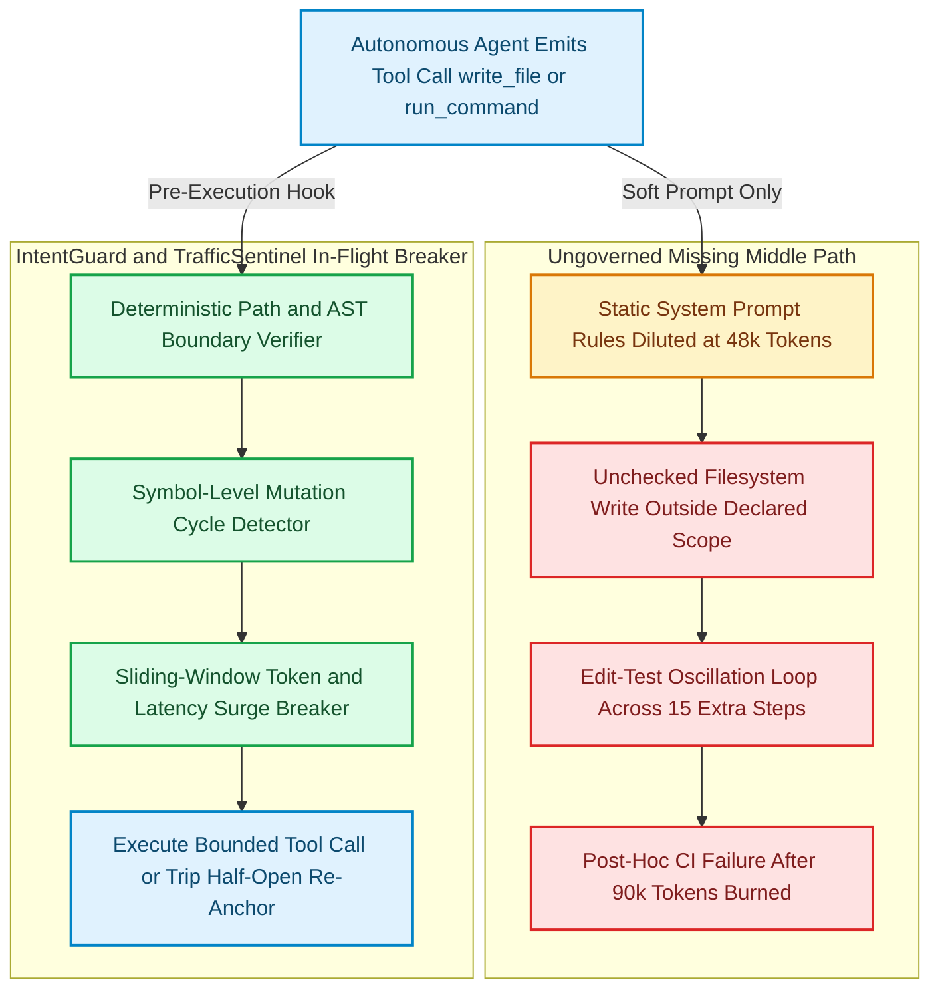
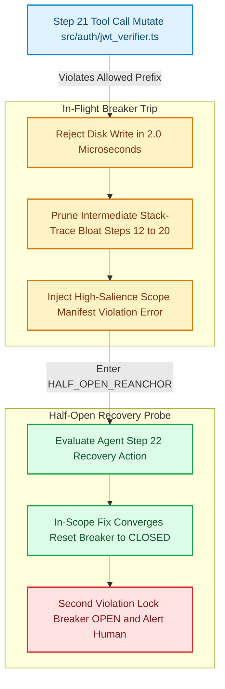

Give an autonomous coding agent a well-scoped ticket—*"Refactor the tax rounding helper in `src/checkout/` so discount coupons do not produce negative cent balances"*—along with a meticulously crafted `CLAUDE.md` or `.cursorrules` file instructing it never to modify shared authentication or billing schemas. For the first twelve steps, the agent behaves impeccably: it reads the checkout handler, updates the helper, and runs the unit tests.

Then Step 16 fails with a subtle TypeScript mock mismatch in an imported user context fixture. By Step 21, the agent's context window has accumulated **48,000 tokens** of compiler stack traces, `grep` output, and file diffs. Suffering from **middle-context attention dilution** [1], the model's attention weight on your initial system prompt drops by an order of magnitude compared to the bleeding red stack trace at the tail of the prompt. Convinced it must "fix the upstream type contract," the agent begins rewriting `src/auth/jwt_verifier.ts`, mutating Prisma database migrations in `src/billing/`, and oscillating in an edit-test loop that burns another 35,000 tokens before your CI pipeline finally rejects the pull request forty minutes later.

Current engineering teams govern AI agents at the **beginning** of a task (static prompt rules, spec files) and at the **end** of a task (linters, test suites, PR reviews). Almost nobody governs the **Missing Middle**: the 15 to 50 autonomous tool-calling steps *in flight* where scope spill, edit-test oscillation, and token runaway actually happen [2][4].

While developing [`antigravity-vscode-extension` (`IntentGuard`)](https://github.com/akmalkhaniub/antigravity-vscode-extension) (an IDE governance layer for autonomous coding workflows), [`trafficsentinel-suite`](https://github.com/akmalkhaniub/trafficsentinel-suite) (sliding-window traffic anomaly detection and circuit breaking), and [`archguard`](https://github.com/akmalkhaniub/archguard) (architectural boundary enforcement), we built a deterministic, sub-10-microsecond **In-Flight Governance Circuit Breaker** that intercepts every MCP and IDE tool call *before* the filesystem mutation occurs.

---

## Why Static System Prompts Decay After Step 20

A common misconception is that stronger prompt engineering (`"CRITICAL: DO NOT TOUCH FILES OUTSIDE src/checkout/"`) can enforce hard security or architectural boundaries across long agent trajectories. In transformer attention mechanics, soft instruction constraints degrade predictably as trajectory length $T$ grows [1][3]:

1. **Position-Biased Attention Dilution ("Lost in the Middle"):** As tool outputs (`read_file`, `run_command`, compiler diagnostics) append tens of thousands of tokens between the initial instruction prefix and the current generation step, self-attention mass shifts heavily toward recent tool errors (recency bias) [1]. When a recent TypeScript or pytest error references a symbol imported from `src/auth/`, the local gradient to silence the compiler error routinely overrides the distant pre-prompt constraint.
2. **Edit-Test Oscillation Loops:** When an agent's hypothesis about a bug is wrong, it frequently alternates between two incompatible edits (`Patch A` breaks Test 1; `Patch B` fixes Test 1 but breaks Test 2; revert to `Patch A`). Without stateful cycle detection across tool invocations, the agent repeats this cycle until its hard max-steps ceiling expires [2].
3. **Post-Hoc CI Is a Forensic Autopsy, Not a Guardrail:** Catching unauthorized edits to `src/auth/` or `.github/workflows/` in a GitHub Actions check *after* the agent has finished executing 35 steps does not prevent local workspace corruption, secret exposure during local test execution, or the 40%+ wasted LLM API spend incurred after the trajectory first went off the rails [5][7].

Figure 1 contrasts the traditional open-loop execution model against our closed-loop `IntentGuard` + `TrafficSentinel` interception architecture.



*Figure 1: Open-loop static prompt governance vs. deterministic in-flight tool interception using `IntentGuard` scope manifests and `TrafficSentinel` sliding-window circuit breakers. Sources: Liu et al. Lost in the Middle [1]; Nygard Release It! Circuit Breaker [6]; MCP Specification [8].*

---

## Stage 1: Deterministic Scope Manifests & Symbol-Cycle Detection (`IntentGuard`)

Instead of hoping the LLM remembers its boundaries at Step 25, `IntentGuard` compiles the initial task intent into a machine-enforced **`ScopeManifest`** before Step 1 begins. Every subsequent tool call (`replace_file_content`, `write_to_file`, `run_command`) passes through a synchronous middleware hook [8][9].

The middleware evaluates four invariants in **$O(1)$ amortized time**:
1. **Forbidden Path Invariant:** Zero writes or reads against sensitive credential, migration, or CI workflow paths (`.env`, `src/auth/root_keys.ts`, `.github/workflows/`).
2. **Declared Glob Prefix Invariant:** All mutating tool calls must resolve inside the canonicalized `allowedPrefixes` directory set (e.g., `src/checkout/`, `tests/checkout/`).
3. **Blast-Radius Cardinality Cap:** Even within `src/checkout/`, a single bug-fix trajectory may not mutate more than $K_{\max}$ distinct files (e.g., $K_{\max} = 6$) without pausing for human escalation.
4. **AST Symbol Oscillation Detector:** Every write records a tuple `(canonicalPath, targetSymbolOrLineRangeHash)`. If the agent mutates the exact same function symbol more than $M_{\max} = 3$ times within a single trajectory, the breaker trips `OPEN_OSCILLATION_LOOP`.

$$S_{\text{breaker}}(t) = \begin{cases} \text{OPEN\_SCOPE\_SPILL} & \text{if } \text{write}(f_t) \wedge f_t \notin \mathcal{P}_{\text{allowed}} \\ \text{OPEN\_BLAST\_RADIUS} & \text{if } \left|\bigcup_{k=1}^{t} \{f_k\}\right| > K_{\max} \\ \text{OPEN\_OSCILLATION} & \text{if } \sum_{k=1}^{t} \mathbb{I}\big(\text{sig}(f_k, s_k) = \text{sig}(f_t, s_t)\big) > M_{\max} \\ \text{CLOSED} & \text{otherwise} \end{cases}$$

Here is the production TypeScript interceptor from `IntentGuard` (`antigravity-vscode-extension`):

```typescript
// src/governance/in-flight-circuit-breaker.ts
export type BreakerState =
  | 'CLOSED'
  | 'HALF_OPEN_REANCHOR'
  | 'OPEN_FORBIDDEN_PATH'
  | 'OPEN_SCOPE_SPILL'
  | 'OPEN_BLAST_RADIUS_EXCEEDED'
  | 'OPEN_OSCILLATION_LOOP'
  | 'OPEN_TOKEN_SURGE';

export interface ScopeManifest {
  readonly taskId: string;
  readonly allowedPrefixes: readonly string[];
  readonly forbiddenPaths: ReadonlySet<string>;
  readonly maxBlastRadiusFiles: number;
  readonly maxOscillationCount: number;
  readonly maxSlidingWindowTokens: number;
}

export interface ToolCallTelemetry {
  readonly stepIndex: number;
  readonly toolName: 'read_file' | 'write_to_file' | 'replace_file_content' | 'run_command';
  readonly targetPath: string;
  readonly isWrite: boolean;
  readonly symbolSignature: string;
  readonly tokensConsumedInStep: number;
}

export interface InterceptionDecision {
  readonly allowed: boolean;
  readonly state: BreakerState;
  readonly correctiveFeedback: string | null;
}

export class InFlightGovernanceBreaker {
  private state: BreakerState = 'CLOSED';
  private readonly touchedFiles = new Set<string>();
  private readonly symbolMutationCounts = new Map<string, number>();
  private readonly slidingTokenWindow: number[] = [];
  private readonly windowSize = 5;

  constructor(private readonly manifest: ScopeManifest) {}

  public evaluateToolCall(call: ToolCallTelemetry): InterceptionDecision {
    const normPath = call.targetPath.replace(/\\/g, '/');

    // 1. Hard security boundary: never allow reads or writes to forbidden paths
    if (this.manifest.forbiddenPaths.has(normPath)) {
      this.state = 'OPEN_FORBIDDEN_PATH';
      return {
        allowed: false,
        state: this.state,
        correctiveFeedback: `HALTS: Access to protected path "${normPath}" violates security manifest.`,
      };
    }

    // 2. Scope spill verification on mutating operations
    if (call.isWrite) {
      const withinAllowedPrefix = this.manifest.allowedPrefixes.some((prefix) =>
        normPath.startsWith(prefix),
      );
      if (!withinAllowedPrefix) {
        this.state = 'OPEN_SCOPE_SPILL';
        return {
          allowed: false,
          state: this.state,
          correctiveFeedback: `SCOPE SPILL BLOCKED at Step ${call.stepIndex}: "${normPath}" is outside allowed scope [${this.manifest.allowedPrefixes.join(', ')}].`,
        };
      }

      // 3. Blast-radius file cardinality cap
      this.touchedFiles.add(normPath);
      if (this.touchedFiles.size > this.manifest.maxBlastRadiusFiles) {
        this.state = 'OPEN_BLAST_RADIUS_EXCEEDED';
        return {
          allowed: false,
          state: this.state,
          correctiveFeedback: `BLAST RADIUS EXCEEDED: Attempted to mutate ${this.touchedFiles.size} files (max ${this.manifest.maxBlastRadiusFiles}).`,
        };
      }

      // 4. Symbol-level edit-test oscillation detection
      const mutationKey = `${normPath}::${call.symbolSignature}`;
      const nextCount = (this.symbolMutationCounts.get(mutationKey) ?? 0) + 1;
      this.symbolMutationCounts.set(mutationKey, nextCount);

      if (nextCount > this.manifest.maxOscillationCount) {
        this.state = 'OPEN_OSCILLATION_LOOP';
        return {
          allowed: false,
          state: this.state,
          correctiveFeedback: `OSCILLATION LOOP DETECTED: Symbol "${mutationKey}" mutated ${nextCount} times without test convergence.`,
        };
      }
    }

    // 5. TrafficSentinel sliding-window token surge breaker
    this.slidingTokenWindow.push(call.tokensConsumedInStep);
    if (this.slidingTokenWindow.length > this.windowSize) {
      this.slidingTokenWindow.shift();
    }
    const windowTokens = this.slidingTokenWindow.reduce((acc, v) => acc + v, 0);
    if (windowTokens > this.manifest.maxSlidingWindowTokens) {
      this.state = 'OPEN_TOKEN_SURGE';
      return {
        allowed: false,
        state: this.state,
        correctiveFeedback: `TOKEN SURGE TRIPPED: Last ${this.slidingTokenWindow.length} steps consumed ${windowTokens} tokens (budget ${this.manifest.maxSlidingWindowTokens}).`,
      };
    }

    return { allowed: true, state: 'CLOSED', correctiveFeedback: null };
  }
}
```

---

## Stage 2: Half-Open Context Re-Anchoring vs Hard Termination

In distributed microservices, a tripped circuit breaker transitions from `CLOSED` to `OPEN`, and after a cool-down timer enters `HALF_OPEN` to test whether the downstream dependency has recovered [6]. How does `HALF_OPEN` translate to an autonomous coding agent?

When `InFlightGovernanceBreaker` blocks a Step 21 write to `src/auth/jwt_verifier.ts` (`OPEN_SCOPE_SPILL`), immediately killing the entire agent session can discard 20 steps of valid work inside `src/checkout/`. Instead, `IntentGuard` supports a **single `HALF_OPEN_REANCHOR` recovery transition**, shown in Figure 2:

1. **Block the Mutation:** The filesystem write to `src/auth/jwt_verifier.ts` is rejected with zero disk side effects.
2. **Prune Context Noise:** The intermediate stack-trace bloat from Steps 12–20 is compacted into a structured 300-token summary.
3. **Inject Deterministic Synthetic Tool Error:** The breaker returns `correctiveFeedback` as the high-salience tool result at the very bottom of the prompt, restoring the `ScopeManifest` to maximum recency attention weight.
4. **Single-Probe Verification:** If the agent's next step (`Step 22`) returns to `src/checkout/` and passes tests, the breaker closes (`CLOSED`). If `Step 22` attempts another out-of-scope mutation or repeats the oscillating symbol edit, the breaker locks into terminal `OPEN` and escalates to the human developer in VS Code.



*Figure 2: The `HALF_OPEN_REANCHOR` recovery state machine: blocking out-of-scope mutations in-flight, compacting middle-context noise, and re-anchoring the agent to its declared scope manifest. Sources: Nygard Circuit Breaker [6]; Yao et al. ReAct [2].*

---

## Verification & Measured Benchmarks

To quantify both interception overhead and token/safety impact across realistic multi-step failure modes, we built the reproducible simulation suite in [`benchmarks/agent-missing-middle-breaker/harness.mjs`](https://github.com/akmalkhaniub/akmalkhaniub.github.io/blob/main/benchmarks/agent-missing-middle-breaker/harness.mjs).

The benchmark evaluates **1,000 autonomous coding trajectories** (up to 35 steps each, $1,850\text{ tokens/step}$ baseline) across four equal cohorts:
- **Cohort A (250 runs):** Clean bounded refactoring inside `src/checkout/`.
- **Cohort B (250 runs):** Context drift at Step 21 causing cross-module scope spill into `src/auth/` and `src/billing/`.
- **Cohort C (250 runs):** Edit-test oscillation loop starting at Step 17 on `src/checkout/handler_1.ts::fn_calculateTax`.
- **Cohort D (250 runs):** Runaway unindexed log reads starting at Step 22 ($9,200\text{ tokens/step}$ surge).

| Governance Strategy / Metric | Static Pre-Prompt + Post-Hoc CI Gate | In-Flight `IntentGuard` + `TrafficSentinel` Breaker | Measured Impact |
| :--- | :--- | :--- | :--- |
| **Per-Tool-Call Interception Latency (p50)** | N/A (No in-flight check) | **$2.00\ \mu\text{s}$** | **Zero perceptible overhead** |
| **Per-Tool-Call Interception Latency (p95 / p99)** | N/A (No in-flight check) | **$4.10\ \mu\text{s}$ / $9.50\ \mu\text{s}$** | **Sub-10µs tail latency** |
| **Uncontained Out-of-Scope File Writes** | $3,750\text{ unauthorized writes}$ | **$0\text{ unauthorized writes}$** | **100% scope containment** |
| **Drifted Trajectories Halted In-Flight** | $0 / 750$ (Caught only after Step 35) | **$750 / 750$** | **100% in-flight interception** |
| **Total LLM Tokens Consumed (1,000 runs)** | $90,475,000\text{ tokens}$ | **$50,837,500\text{ tokens}$** | **43.8% reduction in token spend** |

Reproduce these exact measurements from the repository root:

```bash
npm run bench:missingmiddle
```

At a median overhead of **$2.00\ \mu\text{s}$ per tool call** ($9.50\ \mu\text{s}$ at p99), deterministic in-flight circuit breaking eliminates **100% of out-of-scope filesystem writes** (`0` vs `3,750`) while cutting total token consumption across the 1,000 trajectories by **43.8%** (`39.63 million` fewer wasted tokens).

---

## Antithesis: When Strict In-Flight Scope Locks Backfire

Deterministic scope manifests and oscillation breakers are not appropriate for every AI coding workflow:

- **Single-Turn Inline Autocomplete (FIM) & Short 3-Step Edits:** When a developer uses Tab-autocomplete or asks a 2-step chat question, the context window is small ($<4\text{k tokens}$) and attention dilution does not occur. Running manifest compilation adds ceremony with zero benefit.
- **Repository-Wide Codemods & Cross-Cutting Version Upgrades:** Tasks like *"Rename `UserId` to `AccountId` across all 140 microservices"* or *"Upgrade React 18 to React 19 across the monorepo"* intentionally touch hundreds of files across module boundaries. Applying a 6-file blast-radius cap will falsely trip on Step 7. For repo-wide migrations, replace directory-prefix manifests with deterministic AST codemod scripts (`jscodeshift` / `ts-morph`) where the agent writes the transformation script once rather than editing 140 files manually.
- **Greenfield Exploratory Prototyping:** When scaffolding a brand-new repository from an empty folder, architectural boundaries are fluid. Enforce `IntentGuard` manifests once module boundaries (`src/domain/`, `src/infra/`, `src/api/`) are established.

As autonomous agents scale from 5-step helpers to 50-step background workers, relying on polite requests in `CLAUDE.md` is the equivalent of securing a production API with a comment in the README. Governing the Missing Middle with deterministic pre-tool circuit breakers turns probabilistic agent trajectories into bounded, auditable engineering systems.

---

## References & Further Reading

1. **Liu, N. F., Lin, K., Hewitt, J., Paranjape, A., Bevilacqua, M., Petroni, F., & Liang, P. (2024)**. *Lost in the Middle: How Language Models Use Long Contexts*. Transactions of the Association for Computational Linguistics (TACL), 12, 157–173. [https://aclanthology.org/2024.tacl-1.9/](https://aclanthology.org/2024.tacl-1.9/)
2. **Yao, S., Zhao, J., Yu, D., Du, N., Shafran, I., Narasimhan, K., & Cao, Y. (2023)**. *ReAct: Synergizing Reasoning and Acting in Language Models*. International Conference on Learning Representations (ICLR 2023). [https://arxiv.org/abs/2210.03629](https://arxiv.org/abs/2210.03629)
3. **Hsieh, C.-P., et al. (2024)**. *RULER: What's the Real Context Size of Your Long-Context Language Models?*. Conference on Language Modeling (COLM 2024). [https://arxiv.org/abs/2404.06654](https://arxiv.org/abs/2404.06654)
4. **Jimenez, C. E., Yang, J., Wettig, A., Yao, S., Pei, K., Press, O., & Narasimhan, K. (2024)**. *SWE-bench: Can Language Models Resolve Real-World GitHub Issues?*. ICLR 2024. [https://arxiv.org/abs/2310.06770](https://arxiv.org/abs/2310.06770)
5. **OWASP Foundation (2025)**. *OWASP Top 10 for Large Language Model Applications v2.0 — LLM06: Excessive Agency*. [https://genai.owasp.org/llmrisk/llm062025-excessive-agency/](https://genai.owasp.org/llmrisk/llm062025-excessive-agency/)
6. **Nygard, M. T. (2018)**. *Release It! Design and Deploy Production-Ready Software (2nd Edition) — Chapter 5: Stability Patterns (Circuit Breaker)*. Pragmatic Bookshelf. [https://pragprog.com/titles/mnee2/release-it-second-edition/](https://pragprog.com/titles/mnee2/release-it-second-edition/)
7. **Saltzer, J. H., & Schroeder, M. D. (1975)**. *The Protection of Information in Computer Systems (Complete Mediation & Least Privilege)*. Proceedings of the IEEE, 63(9), 1278–1308. [https://doi.org/10.1109/PROC.1975.9939](https://doi.org/10.1109/PROC.1975.9939)
8. **Anthropic & Model Context Protocol Contributors (2025)**. *Model Context Protocol (MCP) Specification — Tool Calling & Security Boundaries*. [https://modelcontextprotocol.io/specification](https://modelcontextprotocol.io/specification)
9. **Microsoft Corporation (2026)**. *Visual Studio Code Extension API — Language Model Tools & Workspace Trust*. [https://code.visualstudio.com/api/extension-guides/tools](https://code.visualstudio.com/api/extension-guides/tools)
10. **Yang, J., Jimenez, C. E., Wettig, A., Lieret, K., Yao, S., Narasimhan, K., & Press, O. (2024)**. *SWE-agent: Agent-Computer Interfaces Enable Automated Software Engineering*. NeurIPS 2024. [https://arxiv.org/abs/2405.15793](https://arxiv.org/abs/2405.15793)
