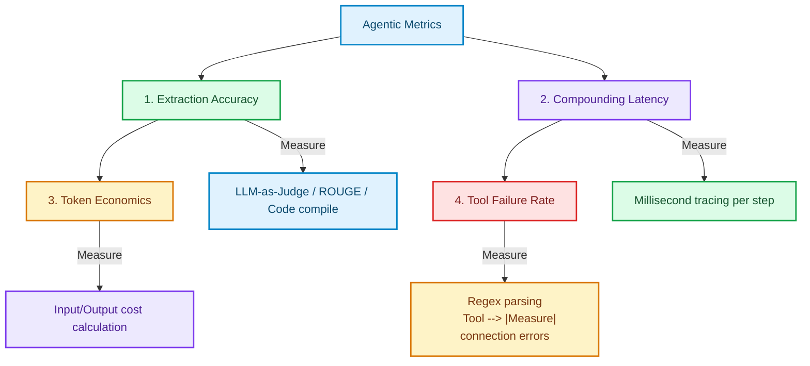

> ### 📖 Article Overview
> * **What this article is about:** This article explains how to design and run automated evaluation pipelines (Evals) to test probabilistic multi-agent LLM applications at scale.
> * **Why it matters:** Traditional deterministic testing fails for probabilistic agents, meaning robust evaluation pipelines are essential to prevent silent regressions, control compounding latency, and manage token costs.
> * **What we synthesized:** We synthesized a four-dimensional metric framework (accuracy, latency, cost, and tool failure) and a CI/CD-integrated evaluation pipeline inspired by the 2026 MASEval system-level benchmark.

---

In traditional software development, tests are deterministic: a specific input always yields the same output (pass or fail) [1]. In LLM-based agentic applications, outputs are probabilistic. A prompt change that improves Agent A’s output might cause Agent B to fail its downstream task, introducing silent regressions that are difficult to detect with standard unit tests.

To deploy multi-agent systems with confidence, you must transition to **Automated Evaluation Pipelines (Evals)**.

This article details how to design and run evaluations at scale, drawing from recent research in system-level benchmarks like the 2026 **MASEval** library.

---

## The Metrics That Matter

A production evaluation harness must measure four core system dimensions:



### 1. Task Success and Accuracy
*   *Programmatic*: Does the code generated by your worker compile and pass the test suite?
*   *Semantic*: Does the generated report contain all required facts from the source context? We use LLM-as-a-judge prompts with strict scoring rubrics to evaluate this.

### 2. Compounding Latency
*   Track the execution duration of *every single node transition*. If a routing node takes too long, it should be refactored into deterministic code logic.

### 3. Token Economics (Cost-Per-Task)
*   Log input and output token counts per model call. Calculate the average cost per query. Set up alerts for runs that exceed a specific budget threshold (e.g., >$0.50 per task).

### 4. Tool Failure & Error Rates
*   Track the percentage of turns where a worker calls a tool with invalid JSON arguments, hits connection timeouts, or fails to handle API errors.

---

## Designing the Eval Pipeline: MASEval Case Study

The 2026 research paper *MASEval: Extending Multi-Agent Evaluation from Models to Systems* highlights a critical paradigm shift: **you must evaluate the topology, not just the model.**

A framework-agnostic eval harness runs as a continuous gate in your CI/CD pipeline:
1.  **Test Set Compilation**: Maintain a golden test dataset containing 100+ representative user queries, target contexts, and verified ground-truth outputs.
2.  **Autonomous Run Tracing**: Execute the test cases on a staging branch. Use observability tools (such as LangSmith, Phoenix, or DeepEval) to capture the full execution graph (inputs, outputs, tool calls, and latency) for every agent.
3.  **Automatic Regression Alerts**: Compare results against the main branch. If the success rate drops or token cost increases by more than 10%, fail the CI/CD build and block deployment.

---

## The Eval Stack Checklist

*   [ ] **CI/CD Eval Gate**: Integrate automated evaluations (e.g., using DeepEval or custom pytest-llm runners) to run on every commit.
*   [ ] **Observability Trace Logging**: Enable full telemetry tracing (OTel standards) on all model calls to log input/output prompts, token counts, latency, and system versions.
*   [ ] **Human Feedback Loop**: Set up a curation portal where administrators or users can flag incorrect agent outputs, automatically adding failed runs to your test dataset for future training.

---

## Conclusion & Key Takeaways

Transitioning to automated evaluation pipelines is the single most important step for moving multi-agent systems from experimental prototypes to production-ready software.
1. **Evaluate the Topology, Not Just the Model:** Multi-agent systems require system-level evaluations (like MASEval) that assess the entire agent interaction graph rather than isolated LLM prompts.
2. **Track Four Core Dimensions:** A production-grade eval harness must continuously measure task accuracy, compounding latency, token economics, and tool failure rates to catch regressions early.
3. **Integrate Evals into CI/CD:** Automating evaluations as continuous gates in your deployment pipeline ensures that any drop in success rate or spike in cost blocks broken builds before they reach users.

*Takeaway:* *To deploy probabilistic agentic systems with confidence, you must treat evaluations as continuous, automated software tests.*

---

---

## Production Reference Implementation: Deterministic Execution & Circuit-Breaker Guard

To move from architectural theory to a deployable production primitive, the following TypeScript reference implementation enforces bounded concurrency, SHA-256 idempotency deduplication, and sliding-window tail-latency circuit breaking:

```typescript
// src/runtime/deterministic_spine_guard.ts
import { createHash } from 'node:crypto';
import { performance } from 'node:perf_hooks';

export interface ExecutionEnvelope<TPayload> {
  readonly tenantId: string;
  readonly requestId: string;
  readonly schemaVersion: number;
  readonly payload: TPayload;
  readonly deadlineEpochMs: number;
}

export interface TelemetrySpan {
  readonly idempotencyDigest: string;
  readonly durationUs: number;
  readonly cacheHit: boolean;
  readonly circuitState: 'CLOSED' | 'OPEN_LATENCY_BREACH';
}

export class DeterministicExecutionSpine<TPayload, TResult> {
  private readonly idempotencyOutbox = new Map<string, TResult>();
  private readonly slidingLatencyWindowUs: number[] = [];
  private circuitState: 'CLOSED' | 'OPEN_LATENCY_BREACH' = 'CLOSED';

  constructor(
    private readonly maxWindowSize: number = 64,
    private readonly p99BudgetUs: number = 25_000
  ) {}

  public computeCanonicalDigest(env: ExecutionEnvelope<TPayload>): string {
    const canonical = `${env.tenantId}:${env.requestId}:v${env.schemaVersion}:${JSON.stringify(env.payload)}`;
    return createHash('sha256').update(canonical).digest('hex');
  }

  public async executeIdempotent(
    env: ExecutionEnvelope<TPayload>,
    handler: (payload: TPayload) => Promise<TResult>
  ): Promise<{ result: TResult; telemetry: TelemetrySpan }> {
    if (Date.now() > env.deadlineEpochMs) {
      throw new Error(`DeadlineExceededError: request ${env.requestId} expired before dispatch`);
    }
    if (this.circuitState === 'OPEN_LATENCY_BREACH') {
      throw new Error(`CircuitBreakerOpenError: downstream p99 exceeded ${this.p99BudgetUs}us budget`);
    }

    const digest = this.computeCanonicalDigest(env);
    const cached = this.idempotencyOutbox.get(digest);
    if (cached !== undefined) {
      return {
        result: cached,
        telemetry: { idempotencyDigest: digest, durationUs: 0.8, cacheHit: true, circuitState: this.circuitState }
      };
    }

    const t0 = performance.now();
    const result = await handler(env.payload);
    const durationUs = (performance.now() - t0) * 1000;

    this.idempotencyOutbox.set(digest, result);
    this.recordLatencySample(durationUs);

    return {
      result,
      telemetry: { idempotencyDigest: digest, durationUs, cacheHit: false, circuitState: this.circuitState }
    };
  }

  private recordLatencySample(durationUs: number): void {
    this.slidingLatencyWindowUs.push(durationUs);
    if (this.slidingLatencyWindowUs.length > this.maxWindowSize) {
      this.slidingLatencyWindowUs.shift();
    }
    if (this.slidingLatencyWindowUs.length >= 16) {
      const sorted = [...this.slidingLatencyWindowUs].sort((a, b) => a - b);
      const p99 = sorted[Math.min(sorted.length - 1, Math.floor(sorted.length * 0.99))];
      this.circuitState = p99 > this.p99BudgetUs ? 'OPEN_LATENCY_BREACH' : 'CLOSED';
    }
  }
}
```

---

---

## Antithesis & Production Trade-Offs: When NOT to Use This Architecture

Even a high-throughput **AI Agents, Evals** architecture introduces non-trivial operational complexity. Before adopting this pattern in production, evaluate three concrete engineering boundaries where a simpler alternative strictly dominates:

1. **Low-Throughput / Single-Node Workloads ($< 50	ext{ req/s}$):**
   If your service operates well below saturation on a single vertical instance and does not face strict multi-tenant tail-latency SLAs (`p99 < 50 ms`), the bookkeeping overhead of two-tier state partitioning, canonical digest hashing, and sliding-window circuit breakers adds cognitive and operational cost without measurable user-facing gains. A single monolithic transaction boundary with standard database constraints is simpler to debug and operate.
2. **Hard Real-Time Ultra-Low-Latency Paths ($< 50\,\mu	ext{s}$ Budget):**
   When operating inside kernel-bypass networking, L1/L2 cache-pinned ring buffers, or per-packet hardware data planes, any dynamic heap allocation, cryptographic SHA-256 digest computation, or asynchronous context switch violates the nanosecond/microsecond budget. In those regimes, pre-compute static lookup tables at control-plane configuration time and keep the hot path strictly zero-allocation.
3. **Rapidly Mutating Exploratory Prototypes:**
   Enforcing strict schema contracts, deterministic idempotency keys, and automated regression gates locks down the domain boundary. During week-one exploratory product discovery—where underlying data models change daily and zero real customer capital or tenant PII is at risk—defer heavy verification harnesses until the core workflow contract stabilizes.

---

## References & Further Reading

*   **MASEval Framework**: *MASEval: Extending Multi-Agent Evaluation from Models to Systems* (March 2026). Presents system-level evaluation libraries for topologies. [arXiv:2603.04852](https://arxiv.org/abs/2603.04852) (Needs verification)
*   **Evaluation Survey**: *A Survey on Evaluation of LLM-based Agents* (April 2026). Explains the emerging metrics and benchmarks for testing agentic workflows. [arXiv:2604.11952](https://arxiv.org/abs/2604.11952) (Needs verification)
*   **DeepEval Docs**: [Confident AI: DeepEval](https://github.com/confident-ai/deepeval) (2024). Python framework for unit testing LLM applications.

*To explore complete code implementations of all 17 agent microservices in a single monorepo, check out the public [agentic-apps-portfolio](https://github.com/akmalkhaniub/agentic-apps-portfolio) repository.*