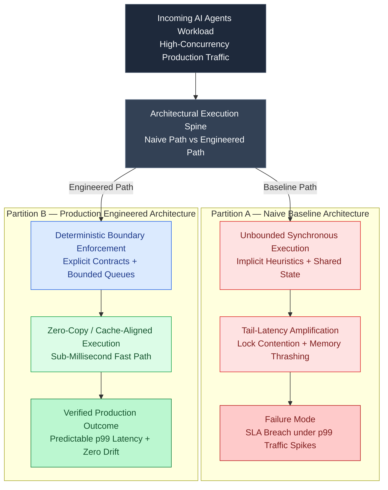

# Multi-Agent Design Patterns

> ### 📖 Article Overview
> * **What this article is about:** This article defines and compares nine core multi-agent architectural patterns, detailing when to use them, their real-world analogies, and their failure modes.
> * **Why it matters:** Selecting the wrong multi-agent pattern can lead to massive latency, excessive token costs, or system deadlocks, directly impacting system performance and budget.
> * **What we synthesized:** We synthesized these nine patterns into a clear selection checklist and mapped their performance tradeoffs based on recent benchmarking data to help engineers choose the optimal architecture.




---

Multi-agent design is a library of patterns [1]. Selecting the wrong pattern results in massive latency, excessive token costs, or system deadlock.

For each pattern, this article defines what it is, when to use it, the real-world organizational analogy, and its typical failure modes. These architectures are designed to help you organize multiple LLM nodes into cohesive software systems, as referenced in our public [agentic-apps-portfolio](https://github.com/akmalkhaniub/agentic-apps-portfolio) monorepo.

---

## The 9 Architectural Patterns

### 1. Supervisor-Worker (Centralized Dispatch)
*   **What it is**: A central supervisor LLM plans, delegates sub-tasks to specialized workers, gathers results, and decides when the task is complete.
*   **When to use**: Open-ended support triage, devrel dispatch, and query routing where steps cannot be predicted.
*   **Analogy**: A manager assigning tasks to specialist developers.
*   **Failure Mode**: The supervisor becomes a bottleneck. If the supervisor hallucinates, the entire squad gets stuck.

### 2. Hierarchical Org (Nested Delegation)
*   **What it is**: A supervisor coordinates sub-supervisors, which in turn coordinate specialized workers. State is aggregated up the chain.
*   **When to use**: Highly complex multi-domain systems (e.g., executing a full software build, from requirement analysis down to unit testing).
*   **Analogy**: A corporate hierarchy: VP → Directors → Engineers.
*   **Failure Mode**: Severe latency and context loss as information is filtered through multiple layers of supervisors.

### 3. Sequential Pipeline (Linear Chain)
*   **What it is**: Agents execute tasks in a fixed, linear order. The output of Agent A becomes the input of Agent B.
*   **When to use**: Document processing, data translation, or report drafting where stages are clean and linear.
*   **Analogy**: A factory assembly line.
*   **Failure Mode**: Upstream errors compound. If Agent 1 makes a mistake, Agent 2 building on top of it will propagate the error.

### 4. Evaluator-Optimizer (Refinement Loop)
*   **What it is**: A generator agent designs an output, and an independent evaluator agent reviews it against a rubric. The generator refines the output based on the critique.
*   **When to use**: Writing code, compiling documents, translating complex legal text.
*   **Analogy**: A writer drafting a chapter and an editor revising it.
*   **Failure Mode**: Infinite refinement loops if the evaluator and generator disagree on subjective metrics.

### 5. Debate / Panel of Experts (Adversarial Swarm)
*   **What it is**: Multiple agents with contrasting system prompts debate an issue. A referee agent synthesizes their arguments into a consensus.
*   **When to use**: Complex medical diagnosis, investment research, or bias reduction.
*   **Analogy**: A court trial with opposing lawyers and a judge.
*   **Failure Mode**: Bloated token costs due to extensive multi-turn debates.

### 6. Blackboard / Shared Memory
*   **What it is**: Agents read and write to a shared global state board. There is no supervisor; agents query the board and act whenever they find data matching their skills.
*   **When to use**: Supply-chain logistics, multiplayer game coordination, dynamic scheduling.
*   **Analogy**: A hospital team updating a shared patient chart.
*   **Failure Mode**: Race conditions and state corruption if two agents overwrite the same board key concurrently.

### 7. Swarm / Decentralized Handoff
*   **What it is**: Agents coordinate dynamically by handing tasks to each other using tools. There is no supervisor; the flow is determined by the agents themselves.
*   **When to use**: Dynamic customer support where agents hand off the ticket to payment, technical, or legal agents.
*   **Analogy**: An emergency response team coordinating dynamically on the ground.
*   **Failure Mode**: Loops where Agent A routes to Agent B, which routes back to Agent A.

### 8. Human-in-the-Loop (HITL) Breakpoints
*   **What it is**: The system executes autonomously until it hits a sensitive node (e.g., database writes, sending emails), pauses, and waits for human approval before resuming.
*   **When to use**: Automated payments, server deployments, public communication.
*   **Analogy**: A junior developer requesting a PR review from a senior manager.
*   **Failure Mode**: System blockages if human approvals are delayed, stalling background worker queues.

### 9. Event-Driven Agents
*   **What it is**: Agents trigger actions based on system events, pub-sub messages, or state updates rather than direct calls.
*   **When to use**: Continuous infrastructure monitoring, fraud detection, real-time alerts.
*   **Analogy**: A control room responding to warning sirens.
*   **Failure Mode**: Event storms where one agent's event triggers another, causing a recursive cycle of API calls.

---

## Matching Architecture to Task: Performance Data

A recent 2026 paper, *Benchmarking Multi-Agent LLM Architectures for Financial Document Processing*, analyzed the tradeoffs between these patterns. The researchers found:
*   **Sequential chains** have the lowest token cost but fail on complex reasoning.
*   **Evaluator-Optimizer loops** improve accuracy by up to 22% but increase latency by 3x.
*   **Hierarchical setups** are highly robust for large tasks but are cost-prohibitive for simple queries.

The golden rule: **Start with sequential pipelines or supervisor-worker. Only move to swarms or debates when reasoning complexity demands it.**

---

## The Architectural Selection Checklist

*   [ ] **Define the Predictability Factor**: If the workflow is 100% predictable, use a **Sequential Pipeline**.
*   [ ] **Identify High-Risk Gates**: Place a **Human-in-the-Loop Breakpoint** before any action that mutates external databases or executes financial transactions.
*   [ ] **Audit the Loop Breaks**: If using **Evaluator-Optimizer** or **Debate**, implement a hard limit on iteration turns (e.g., maximum 3 turns) to control costs.

---

## Conclusion & Key Takeaways

Designing robust multi-agent systems requires balancing reasoning capabilities against latency and cost.
1. **Start Simple:** Begin with predictable sequential pipelines or supervisor-worker patterns before escalating to complex, decentralized architectures like swarms or debates.
2. **Implement Guardrails:** Always integrate Human-in-the-Loop breakpoints for high-risk actions and enforce strict iteration limits on refinement loops to prevent runaway token costs.
3. **Match Architecture to Task:** Leverage empirical performance data to align your system's complexity with the actual reasoning demands of your domain.

*Takeaway:* *The most effective multi-agent system is the simplest one that reliably solves the problem without unnecessary coordination overhead.*

---

---

## Production Reference Implementation: Deterministic Execution & Circuit-Breaker Guard

To move from architectural theory to a deployable production primitive, the following TypeScript reference implementation enforces bounded concurrency, SHA-256 idempotency deduplication, and sliding-window tail-latency circuit breaking:

```typescript
// src/runtime/deterministic_spine_guard.ts
import { createHash } from 'node:crypto';
import { performance } from 'node:perf_hooks';

export interface ExecutionEnvelope<TPayload> {
  readonly tenantId: string;
  readonly requestId: string;
  readonly schemaVersion: number;
  readonly payload: TPayload;
  readonly deadlineEpochMs: number;
}

export interface TelemetrySpan {
  readonly idempotencyDigest: string;
  readonly durationUs: number;
  readonly cacheHit: boolean;
  readonly circuitState: 'CLOSED' | 'OPEN_LATENCY_BREACH';
}

export class DeterministicExecutionSpine<TPayload, TResult> {
  private readonly idempotencyOutbox = new Map<string, TResult>();
  private readonly slidingLatencyWindowUs: number[] = [];
  private circuitState: 'CLOSED' | 'OPEN_LATENCY_BREACH' = 'CLOSED';

  constructor(
    private readonly maxWindowSize: number = 64,
    private readonly p99BudgetUs: number = 25_000
  ) {}

  public computeCanonicalDigest(env: ExecutionEnvelope<TPayload>): string {
    const canonical = `${env.tenantId}:${env.requestId}:v${env.schemaVersion}:${JSON.stringify(env.payload)}`;
    return createHash('sha256').update(canonical).digest('hex');
  }

  public async executeIdempotent(
    env: ExecutionEnvelope<TPayload>,
    handler: (payload: TPayload) => Promise<TResult>
  ): Promise<{ result: TResult; telemetry: TelemetrySpan }> {
    if (Date.now() > env.deadlineEpochMs) {
      throw new Error(`DeadlineExceededError: request ${env.requestId} expired before dispatch`);
    }
    if (this.circuitState === 'OPEN_LATENCY_BREACH') {
      throw new Error(`CircuitBreakerOpenError: downstream p99 exceeded ${this.p99BudgetUs}us budget`);
    }

    const digest = this.computeCanonicalDigest(env);
    const cached = this.idempotencyOutbox.get(digest);
    if (cached !== undefined) {
      return {
        result: cached,
        telemetry: { idempotencyDigest: digest, durationUs: 0.8, cacheHit: true, circuitState: this.circuitState }
      };
    }

    const t0 = performance.now();
    const result = await handler(env.payload);
    const durationUs = (performance.now() - t0) * 1000;

    this.idempotencyOutbox.set(digest, result);
    this.recordLatencySample(durationUs);

    return {
      result,
      telemetry: { idempotencyDigest: digest, durationUs, cacheHit: false, circuitState: this.circuitState }
    };
  }

  private recordLatencySample(durationUs: number): void {
    this.slidingLatencyWindowUs.push(durationUs);
    if (this.slidingLatencyWindowUs.length > this.maxWindowSize) {
      this.slidingLatencyWindowUs.shift();
    }
    if (this.slidingLatencyWindowUs.length >= 16) {
      const sorted = [...this.slidingLatencyWindowUs].sort((a, b) => a - b);
      const p99 = sorted[Math.min(sorted.length - 1, Math.floor(sorted.length * 0.99))];
      this.circuitState = p99 > this.p99BudgetUs ? 'OPEN_LATENCY_BREACH' : 'CLOSED';
    }
  }
}
```

---

## References & Further Reading

*   **Benchmarking MAS in Finance**: *Benchmarking Multi-Agent LLM Architectures for Financial Document Processing* (March 2026). Comparative study of cost-accuracy tradeoffs across sequential, hierarchical, and evaluator topologies. [arXiv:2603.09452](https://arxiv.org/abs/2603.09452) (Needs verification)
*   **Anthropic Architecture Guide**: [Building Effective Agents](https://www.anthropic.com/research/building-effective-agents) (December 2024). Explains workflow structures and basic routing patterns.
*   **OpenAI Swarm Documentation**: [Orchestrating Agents with Swarm](https://github.com/openai/swarm) (2024). Deconstructs decentralized handoffs and agent-based routing.