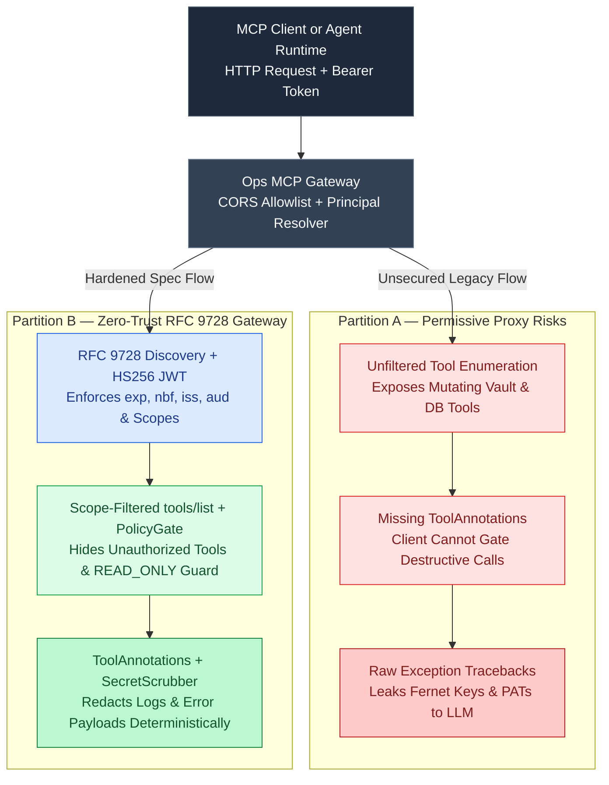

# Zero-Trust Multi-Server MCP Gateways: RFC 9728 Resource Metadata, Scope-Filtered ToolAnnotations, and Secret Scrubbing

As teams scale from single-server desktop integrations to multi-server **Model Context Protocol (MCP)** gateways governing DevOps, databases, MLOps, GitHub, and secret vaults, a permissive proxy rapidly becomes a critical blast-radius multiplier [1, 2]. When 37 operational tools across six specialized MCP servers are exposed through a single HTTP endpoint without least-privilege discovery, three production failures occur immediately: **over-privileged tool enumeration** (LLMs hallucinating destructive mutations they were never authorized to invoke), **ambiguous tool safety semantics** (clients unable to distinguish read-only queries from destructive schema migrations), and **credential leakage through exception logs and error payloads** [1, 3, 4].

In **[Ops MCP Suite (`ops-mcp-suite`)](https://github.com/akmalkhaniub/ops-mcp-suite)**, we unified six FastMCP servers (`agentops_mcp`, `dbops_mcp`, `devops_mcp`, `github_mcp`, `mlops_mcp`, `secrets_mcp`) behind a zero-trust FastAPI gateway implementing **RFC 9728 OAuth 2.0 Protected Resource Metadata**, **scope-filtered `tools/list` and `403 insufficient_scope` step-up challenges**, explicit MCP **`ToolAnnotations`** across all 37 tools, and a deterministic **log & error secret scrubber** [1, 2, 5].

---

## 1. Zero-Trust Gateway Architecture vs. Permissive MCP Proxies

Traditional internal tool proxies treat authentication as a binary boolean at the perimeter and pass every registered tool to the model context window. Under the MCP Authorization Specification, discovery must precede execution and tool visibility must strictly mirror the caller's attenuated OAuth scopes [1, 2]:



Every unauthenticated tool call fails closed with `HTTP 401` and an **RFC 9728** `WWW-Authenticate` header pointing to `/.well-known/oauth-protected-resource`, while `CORSMiddleware` enforces an explicit origin allowlist (`OPS_CORS_ALLOWED_ORIGINS`) and exposes `WWW-Authenticate` and `Mcp-Session-Id` headers [2, 3].

---

## 2. RFC 9728 Metadata, Scope-Filtered Discovery & `READ_ONLY` PolicyGate

In [`auth_middleware.py`](https://github.com/akmalkhaniub/ops-mcp-suite/blob/main/auth_middleware.py) and [`gateway.py`](https://github.com/akmalkhaniub/ops-mcp-suite/blob/main/gateway.py), every tool in the 6-server suite is mapped to an explicit least-privilege OAuth scope (`ops.read`, `ops.agentops.write`, `ops.dbops.write`, `ops.devops.write`, `ops.github.write`, `ops.mlops.write`, `ops.secrets.read`, `ops.secrets.admin`) [1, 2]:

1. **Protected Resource Metadata (`GET /.well-known/oauth-protected-resource`):** Advertises the gateway `resource` URI, `authorization_servers`, `scopes_supported`, and `bearer_methods_supported` per RFC 9728 [2].
2. **Scope-Filtered `GET /{server_id}/tools`:** When a caller presents a verified HS256 JWT (validating signature in constant time with `hmac.compare_digest`, plus `exp`, `nbf`, `iss`, and `aud`) or explicit `X-Ops-Scopes`, unauthorized tools are stripped before reaching the agent's context window [1, 6].
3. **Step-Up `403 insufficient_scope` + `X-Execution-Mode=READ_ONLY`:** Direct calls to hidden tools return `HTTP 403` with `WWW-Authenticate: Bearer resource_metadata="...", error="insufficient_scope", scope="..."`, while an orthogonal `X-Execution-Mode=READ_ONLY` header blocks all 22 mutating tools even for admin-scoped tokens [1, 6].

```python
@app.get("/{server_id}/tools")
async def list_tools(server_id: str, request: Request):
    """List tools available on a specific MCP server, filtered by caller OAuth scopes."""
    principal = resolve_request_principal(request, require_auth_override=False)
    registered = _extract_mcp_tools(mcp_instance)
    tools = []
    for name, tool in registered.items():
        is_mutating = name in MUTATING_TOOLS
        req_scope = get_required_scope(name, is_mutating=is_mutating)
        if not principal.has_scope(req_scope):
            continue
        tools.append({
            "name": name,
            "description": getattr(tool, "description", ""),
            "execution_tier": "LIVE_MUTATION" if is_mutating else "READ_ONLY",
            "required_scope": req_scope,
            "annotations": _extract_annotations(tool, is_mutating=is_mutating),
        })
    return {"server": info["name"], "tools": tools}
```

---

## 3. MCP `ToolAnnotations` Across All 37 Tools

Relying on tool names or prose docstrings to guess side effects is brittle. Every `@mcp.tool(...)` across all six servers (`agentops_mcp.py`, `dbops_mcp.py`, `devops_mcp.py`, `github_mcp.py`, `mlops_mcp.py`, `secrets_mcp.py`) now declares structured `mcp.types.ToolAnnotations` metadata (`readOnlyHint`, `destructiveHint`, `idempotentHint`, `openWorldHint`) [1]:

- **Read-Only Queries (`readOnlyHint=True, destructiveHint=False`):** `run_query`, `list_tables`, `get_db_stats`, `get_trace_summary`, `list_prompt_versions`, `check_service_health`, `list_repos`, `get_repo_info`, `list_pull_requests`, `search_code`, `get_file_contents`, `list_model_registry`, `fetch_model_metrics`, `compare_models`, `get_secret`, `list_secrets`.
- **Destructive / Mutating Actions (`readOnlyHint=False, destructiveHint=True`):** `apply_migrations`, `clone_database`, `provision_s3_bucket`, `create_iam_policy`, `deploy_docker_container`, `manage_secrets`, `provision_vector_db`, `promote_model`, `store_secret`, `delete_secret`, `rotate_secret`.

This allows MCP clients and HITL harnesses to deterministically prompt for confirmation before destructive operations without brittle regex heuristics on tool descriptions [1].

---

## 4. Credential Scrubbing, Path Confinement & SSRF Hardening

Tool failures often serialize raw environment variables, exception tracebacks, or HTTP headers back to the LLM context or centralized log aggregators. In [`secret_scrubber.py`](https://github.com/akmalkhaniub/ops-mcp-suite/blob/main/secret_scrubber.py), `SecretRedactingFilter` attaches to Python's root and vault loggers while `redact_secrets()` scrubs gateway error payloads before serialization [4]:

- **Pattern & Literal Scrubbing:** Redacts GitHub PATs (`ghp_`, `github_pat_`), AWS Access Keys (`AKIA...`), `Bearer` tokens, generic `sk_`/`ls_api_` API keys, 44-character URL-safe base64 Fernet keys, and literal runtime environment values (`VAULT_MASTER_KEY`, `GITHUB_TOKEN`, `OPS_JWT_HS256_SECRET`, `OPS_GATEWAY_API_KEY`).
- **DB Workspace Confinement & Read-Only SQL:** `dbops_mcp.py` strips SQL comments to block stacked-query injections (`SELECT 1;DROP TABLE users`) and enforces `Path.resolve().is_relative_to(OPS_DB_WORKSPACE_ROOT)` across `run_query`, `provision_database`, and `clone_database` [4].
- **DNS-Rebinding SSRF Guard:** `securityops_mcp.py` validates target hostnames and resolves `socket.getaddrinfo` IPs against loopback, link-local (`169.254.169.254`), and RFC 1918 private ranges before opening TLS connections [4].

> [!IMPORTANT]
> Scrubbing at both the `logging.Filter` layer and the HTTP error-response boundary guarantees that even unhandled `TypeError` or third-party SDK exceptions cannot echo `VAULT_MASTER_KEY` or `GITHUB_TOKEN` back into an agent's reasoning trace.

---

## 5. Micro-Benchmark & Verification Results

We benchmarked $N = 500$ iterations of HS256 JWT Bearer verification and credential log scrubbing on Python 3.14, and executed the full 15-test `pytest` security & spec suite (`tests/test_mcp_spec_2026.py`, `tests/test_security_hardening.py`, `tests/test_mock_gateway.py`, `tests/test_ops_mcp.py`):

| Security / Verification Gate | Measured Result | Engineering Guarantee |
| :--- | :--- | :--- |
| **HS256 JWT Verification (`N = 500`)** | **`0.0419 ms` p50 / `0.0662 ms` p95** | Constant-time HMAC check + `exp`/`nbf`/`iss`/`aud` claims |
| **Secret & Fernet Log Scrubbing (`N = 500`)** | **`0.0702 ms` p50 / `0.1208 ms` p95** | Blocks Fernet, `ghp_`, `AKIA`, Bearer, and env secret leaks |
| **ToolAnnotations Schema Coverage** | **`37 / 37` tools annotated** | Explicit `readOnlyHint` & `destructiveHint` across 6 servers |
| **Full Automated Suite (`pytest tests -v`)** | **`15 / 15 PASSED` (`3.91 s`)** | Verifies RFC 9728, scopes, SSRF, SQLi, path jail, and scrubber |

---

## References & Further Reading

1. Anthropic & Linux Foundation, *"Model Context Protocol Specification: Authorization & ToolAnnotations,"* 2025–2026.
2. M. Jones, P. Hunt, and A. Parecki, *"RFC 9728: OAuth 2.0 Protected Resource Metadata,"* IETF, 2025.
3. M. Jones and D. Hardt, *"RFC 6750: The OAuth 2.0 Authorization Framework: Bearer Token Usage,"* IETF, 2012.
4. OWASP Foundation, *"OWASP Top 10 for Large Language Model Applications & Server-Side Request Forgery Prevention Cheat Sheet,"* 2025.
5. A. Parecki et al., *"OAuth 2.1 Authorization Framework (draft-ietf-oauth-v2-1),"* IETF, 2025.
6. M. Jones, J. Bradley, and N. Sakimura, *"RFC 7519: JSON Web Token (JWT),"* IETF, 2015.
