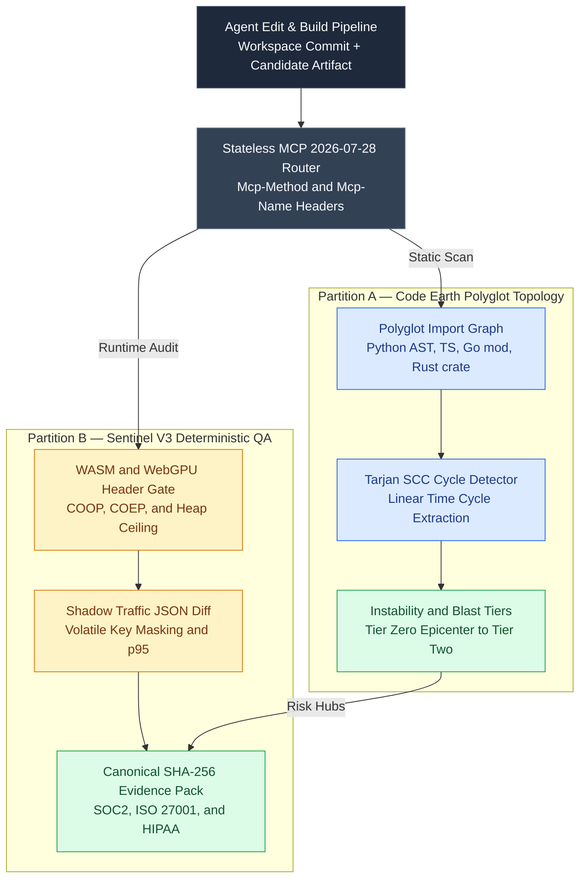

# Polyglot Blast-Radius Topology, Tarjan SCC Cycle Detection, and Zero-Mock MCP 2026-07-28 QA Studios

Autonomous coding agents fail in two predictable ways when operating across real-world polyglot repositories and modern web runtimes: **blind edits without structural blast-radius visibility** [1, 2], and **QA toolchains that return synthetic pass badges instead of evaluating live protocol artifacts** [3]. Modifying a core Go package or Rust crate without knowing its downstream fan-in hubs or circular dependency cycles silently cascades regressions across services [1, 4]. Similarly, browser QA studios that hardcode green checkmarks for Cross-Origin Isolation (`COOP`/`COEP`), shadow-traffic parity, or HTML autofill hygiene give teams false release confidence [5, 6].

Across **[Code Earth (`code-earth`)](https://github.com/akmalkhaniub/code-earth)** and **[Sentinel Autonomous QA (`sentinel`)](https://github.com/akmalkhaniub/sentinel)**, we shipped two cohesive engineering upgrades: a polyglot Python/TypeScript/Go/Rust dependency analyzer with $O(V + E)$ Tarjan strongly connected components (SCC) cycle detection and MCP `2026-07-28` bridge (`0.0724 ms` p50) [1, 3], paired with deterministic artifact evaluation across Sentinel's 5 V3 QA studios and 13 MCP `2026-07-28` tools (`0.0340 ms` p50) [3, 7].

---

## 1. Two-Plane Architecture: Structural Topology Meets Runtime Verification

Modern agentic engineering pipelines separate **pre-execution static topology** (what breaks if a file changes?) from **post-build runtime & contract verification** (did the candidate build regress parity, isolation headers, or compliance?) [2, 3]. Both planes now expose read-only, idempotent `ToolAnnotations` over stateless `Mcp-Method` / `Mcp-Name` HTTP headers (`MCP 2026-07-28`) [3].



---

## 2. Polyglot Dependency Resolution & Tarjan SCC Cycles in Code Earth

Previously, `flight_deck_engine.py` parsed only Python `ast` imports and relative JS/TS `import`/`require` statements, leaving Go and Rust services opaque in monorepos [7]. In [`skills/flight-deck/scripts/graph_analyzer.py`](https://github.com/akmalkhaniub/code-earth/blob/main/skills/flight-deck/scripts/graph_analyzer.py), `build_workspace_graph()` now resolves four ecosystems deterministically without third-party parsers:

- **Go (`go.mod` + package imports):** Extracts the `module` path from `go.mod`, indexes non-test `.go` files by package directory, and maps single-line or block `import (...)` statements back to internal repository files.
- **Rust (`mod` + `use crate::` / `super::`):** Maps `mod <name>;` declarations and crate-relative imports to `<mod>.rs` or `<mod>/mod.rs`, alongside `pub fn`, `struct`, `enum`, and `trait` symbol extraction.
- **Tarjan's SCC & Martin Instability ($I$):** `detect_circular_dependencies()` identifies strongly connected components in $O(V + E)$ time [1], while `compute_architecture_metrics()` computes per-file `fan_in`, `fan_out`, instability $I = \frac{\text{fan\_out}}{\text{fan\_in} + \text{fan\_out}}$ [4], and blast-tier weighted `risk_score`.

```python
def detect_circular_dependencies(
    nodes: Iterable[str], dependencies: Dict[str, Set[str]]
) -> List[List[str]]:
    """Detect circular dependency cycles in O(V + E) using Tarjan's SCC algorithm."""
    index = 0
    indices: Dict[str, int] = {}
    lowlink: Dict[str, int] = {}
    stack: List[str] = []
    on_stack: Set[str] = set()
    cycles: List[List[str]] = []

    def strongconnect(node: str) -> None:
        nonlocal index
        indices[node] = lowlink[node] = index
        index += 1
        stack.append(node)
        on_stack.add(node)

        for neighbor in sorted(dependencies.get(node, ())):
            if neighbor not in indices:
                strongconnect(neighbor)
                lowlink[node] = min(lowlink[node], lowlink[neighbor])
            elif neighbor in on_stack:
                lowlink[node] = min(lowlink[node], indices[neighbor])

        if lowlink[node] == indices[node]:
            scc: List[str] = []
            while True:
                w = stack.pop()
                on_stack.remove(w)
                scc.append(w)
                if w == node:
                    break
            if len(scc) > 1 or node in dependencies.get(node, ()):
                cycles.append(sorted(scc))

    for n in sorted(set(nodes)):
        if n not in indices:
            strongconnect(n)
    return sorted(cycles, key=lambda c: (len(c), c[0]))
```

Running `flight_deck_engine.py --workspace . --json-only --output blast.json` emits CI-consumable blast tiers and cycle reports, while [`code_earth_mcp.py`](https://github.com/akmalkhaniub/code-earth/blob/main/skills/flight-deck/scripts/code_earth_mcp.py) exposes `code_earth_scan_blast_radius`, `code_earth_detect_cycles`, and `code_earth_get_file_anatomy` as read-only MCP `2026-07-28` tools [3, 7].

---

## 3. Zero-Mock Deterministic V3 QA Studios in Sentinel

Sentinel's five newest studios—WASM/WebGPU Runtime, Shadow-Traffic Mirroring, Compliance Evidence Export, Autofill Resilience, and Onboarding Funnel Friction—were upgraded from static mock responses to **artifact-evaluating deterministic analyzers** with timezone-aware `datetime.now(timezone.utc)` timestamps and full exposure in [`sentinel_mcp_bridge.py`](https://github.com/akmalkhaniub/sentinel/blob/main/sentinel_mcp_bridge.py) (13 total `ToolAnnotations`-tagged MCP tools) [3, 8]:

1. **Cross-Origin Isolation & WASM Memory Guard ([`wasm_webgpu_auditor.py`](https://github.com/akmalkhaniub/sentinel/blob/main/wasm_webgpu_auditor.py)):** Evaluates supplied HTTP `response_headers` for `Cross-Origin-Opener-Policy: same-origin` and `Cross-Origin-Embedder-Policy: require-corp` / `credentialless` (required to unlock `SharedArrayBuffer` for multi-threaded WASM) [5], plus `observed_wasm_mb` against `max_wasm_memory_mb`, transitioning to `GPU_WASM_BLOCKED` on violations.
2. **Recursive Shadow-Traffic JSON Parity ([`shadow_traffic_verifier.py`](https://github.com/akmalkhaniub/sentinel/blob/main/shadow_traffic_verifier.py)):** Recursively compares baseline (`v1`) and candidate (`v2`) JSON payloads while masking volatile fields (`timestamp`, `request_id`, `trace_id`, `created_at`, `span_id`), computes exact `v1_p95_ms` vs. `v2_p95_ms` deltas, and sets `overall_status = "PROMOTION_BLOCKED"` on HTTP status drift, `<95%` parity, or `side_effect_leaked=True` [6].
3. **Canonical SHA-256 Compliance Seal ([`compliance_evidence_exporter.py`](https://github.com/akmalkhaniub/sentinel/blob/main/compliance_evidence_exporter.py)):** Computes a reproducible `SHA-256` digest over canonicalized JSON (`sort_keys=True, separators=(",", ":")`) of the project, framework (`SOC2_TYPE_II`, `ISO_27001`, `HIPAA`), and control outcomes—flipping to `REMEDIATION_REQUIRED` whenever any control fails.
4. **HTML Autofill & Funnel Friction Parsers ([`autofill_extension_auditor.py`](https://github.com/akmalkhaniub/sentinel/blob/main/autofill_extension_auditor.py), [`funnel_friction_auditor.py`](https://github.com/akmalkhaniub/sentinel/blob/main/funnel_friction_auditor.py)):** Inspects `<input>` tags for `autocomplete="off"` password anti-patterns, missing email tokens, and missing `data-1p-ignore` / `data-lpignore` attributes on search/promo fields, alongside multi-step `inputmode` and field-count friction scoring.

```python
def _json_diff_fields(
    baseline: Any,
    candidate: Any,
    volatile_keys: set[str],
    prefix: str = "",
) -> Tuple[int, int, List[str]]:
    """Return (total_leaf_comparisons, mismatched_leaves, mismatch_paths)."""
    if isinstance(baseline, dict) and isinstance(candidate, dict):
        keys = set(baseline.keys()) | set(candidate.keys())
        total, mismatches, paths = 0, 0, []
        for k in sorted(keys):
            if k in volatile_keys:
                continue
            child_path = f"{prefix}.{k}" if prefix else k
            if k not in baseline or k not in candidate:
                total += 1
                mismatches += 1
                paths.append(child_path)
            else:
                t, m, p = _json_diff_fields(baseline[k], candidate[k], volatile_keys, child_path)
                total += t
                mismatches += m
                paths.extend(p)
        return (max(1, total), mismatches, paths) if not keys else (total, mismatches, paths)
    return (1, 0, []) if baseline == candidate else (1, 1, [prefix or "$"])
```

---

## 4. Micro-Benchmarks & Full Verification Matrix

All tests and `N = 2,000` micro-benchmarks were executed after final edits on Windows (`Python 3.14.3`) [7, 8]:

| Verification Gate / Benchmark | Measured Result | Architectural Guarantee |
| :--- | :--- | :--- |
| **`compute_architecture_metrics` (`code-earth`, `N = 2,000`)** | **`0.0724 ms` p50 / `0.1095 ms` p95 / `0.2023 ms` p99** | Linear-time Tarjan SCC + Martin instability across workspace |
| **`dispatch_mcp_header_request` (`sentinel_verify_shadow_traffic`, `N = 2,000`)** | **`0.0340 ms` p50 / `0.0769 ms` p95 / `0.1333 ms` p99** | Stateless `Mcp-Method`/`Mcp-Name` + recursive JSON diff |
| **`code-earth` (`pytest tests -v`)** | **`4 / 4 PASSED` (`1.21 s`)** | Python/TS/Go/Rust graph edges, Tarjan cycles, CLI JSON, MCP |
| **`Sentinel` (`pytest tests -q`)** | **`144 / 144 PASSED` (`101.59 s`)** | All 5 V3 studios E2E, PostgreSQL models & 13 MCP tools |

---

## References & Further Reading

1. Robert E. Tarjan, *"Depth-First Search and Linear Graph Algorithms,"* SIAM Journal on Computing, Vol. 1, No. 2, pp. 146–160, 1972.
2. Robert C. Martin, *"Agile Software Development, Principles, Patterns, and Practices (Package Coupling & Instability Metric),"* Prentice Hall, 2002.
3. Model Context Protocol Maintainers, *"Model Context Protocol Specification (`2026-07-28`): ToolAnnotations & Stateless Edge Header Routing,"* Linux Foundation AAIF, 2026.
4. WHATWG & W3C WebAppSec Working Group, *"Cross-Origin-Opener-Policy (COOP), Cross-Origin-Embedder-Policy (COEP), and Cross-Origin Isolation,"* HTML Living Standard, 2026.
5. OASIS Open, *"Static Analysis Results Interchange Format (SARIF) Version 2.1.0,"* OASIS Standard, 2020.
6. Netflix & Envoy Engineering Teams, *"Shadow Traffic Mirroring & Dark-Launch Parity Verification,"* Production Traffic Replay Patterns, 2025.
7. Code Earth Repository, *"[github.com/akmalkhaniub/code-earth](https://github.com/akmalkhaniub/code-earth),"* 2026.
8. Sentinel Autonomous QA Repository, *"[github.com/akmalkhaniub/sentinel](https://github.com/akmalkhaniub/sentinel),"* 2026.
