# The Evolution of RAG: From 2024 to 2026

> ### 📖 Article Overview
> * **What this article is about:** This article traces the architectural journey of Retrieval-Augmented Generation (RAG) from simple linear lookups in 2024 to highly sophisticated, agentic, and multi-tier reasoning ecosystems in 2026.
> * **Why it matters:** Understanding this paradigm shift is critical for engineers to build cost-effective, low-latency, and highly accurate enterprise search systems that outperform obsolete vector-only architectures.
> * **What we synthesized:** We analyzed the core transitions across ingestion, hybrid retrieval, GraphRAG, prompt caching, and agentic orchestration, demonstrating how these technologies consolidate into modern database backends like PostgreSQL.

Two years is an eternity in Generative AI [1]. 

In early 2024, building a Retrieval-Augmented Generation (RAG) system was a weekend scripting project. You wrote a simple parser, split documents into static 500-character chunks, generated embeddings, and queried a vector database using Cosine Similarity. 

If you deploy that same architecture today in 2026, it is considered obsolete. 

Over the last two years, RAG has evolved from a naive, linear lookup script into a highly sophisticated, modular, and agentic software ecosystem. The industry has realized that pure vector similarity is not enough to solve real-world search problems.

This article traces the architectural journey of RAG from 2024 to 2026, mapping the key transitions in ingestion, retrieval, context engineering, and query orchestration.

---

## The RAG Paradigm Shift: 2024 vs. 2026

The transition can be summarized as a shift from **passive, linear text matching** to **active, multi-tier structured reasoning**.

```mermaid
flowchart TD
    subgraph SG1_Year20242024Linear ["Year2024 [2024: Linear Naïve RAG]"]
        Q1["User Query"] -->|Cosine Similarity| V1[(Vector DB)]
        V1 -->|Top K Chunks| G1["LLM Generator"]
        G1 -->|Response| U1["User"]
    end

    subgraph SG2_Year20262026Adaptive ["Year2026 [2026: Adaptive Agentic Ecosystem]"]
        Q2["User Query"] -->|Route & Decompose| Route{Agent Router}
        Route -->|Keywords| Lex[(Sparse Index)]
        Route -->|Vectors| Vec[(pgvector HNSW)]
        Lex --> |Entities| Graph[(GraphRAG Knowledge Base)]
        
        Lex -->|Merge & Score| RRF["Reciprocal Rank Fusion"]
        Vec -->|Merge & Score| RRF
        
        RRF -->|Rerank Chunks| CE["Cross-Encoder Reranker"]
        Graph -->|Pull Entity Subgraphs| CE
        
        CE -->|Structured Context| Cache["Prompt Cache / KV Store"]
        Cache -->|Reason & Synthesize| G2["LLM Engine"]
        G2 -->|Self-Verify| Val{Relevance Grader}
        
        Val -->|Failed Check| Rewrite["Query Rewriter"]
        Rewrite --> Route
        Val -->|Passed Check| U2["Grounded Response"]
    end

    style Year2024 fill:#f8fafc,stroke:#94a3b8,stroke-width:2px
    style Year2026 fill:#ecfeff,stroke:#0ea5e9,stroke-width:2px

classDef green fill:#dcfce7,stroke:#16a34a,stroke-width:2px,color:#14532d;
classDef red fill:#fee2e2,stroke:#dc2626,stroke-width:2px,color:#7f1d1d;
classDef blue fill:#e0f2fe,stroke:#0284c7,stroke-width:2px,color:#0c4a6e;
classDef yellow fill:#fef3c7,stroke:#d97706,stroke-width:2px,color:#78350f;
classDef purple fill:#ede9fe,stroke:#7c3aed,stroke-width:2px,color:#4c1d95;
class Q1,CE blue
class G1,Cache green
class U1,G2 purple
class Q2,Rewrite yellow
class RRF,U2 red
```



---

## Tracing the Core Transformations

### 1. Ingestion: From Static Chunks to Semantic Layouts
* **The 2024 Approach**: Developers split text using arbitrary token or character counts (e.g., *"every 256 tokens"*). This frequently bisected critical tables, sentences, and code blocks, destroying the retrieval context.
* **The 2026 Standard**: We use **Semantic Layout-Aware Ingestion**. Documents are parsed into structural trees (Markdown headers, tables, sections). Systems also leverage **Late Chunking**—where the document is passed through the embedding model in its entirety first, retaining global contextual references inside individual chunk representations.

### 2. Retrieval: From Pure Vector Search to Hybrid Fusion
* **The 2024 Approach**: Systems relied entirely on vector similarity. While excellent at capturing general conceptual similarities, vector search struggled with exact keywords, serial numbers, dates, or product codes.
* **The 2026 Standard**: **Hybrid Retrieval** is mandatory. We merge dense vector search (via high-speed indices like HNSW in `pgvector`) with sparse lexical indexes (like PostgreSQL `tsvector` or BM25) using **Reciprocal Rank Fusion (RRF)**. 
* To filter out the remaining noise, we route results through a **Cross-Encoder Reranking model** (e.g. `bge-reranker-large`). This acts as a secondary deep learning classifier, evaluating the precise relevance of the query-document pair, trimming the candidate list to only the absolute most valuable chunks.

### 3. Knowledge Mapping: The Rise of GraphRAG
* **The 2024 Approach**: Naive RAG could not answer global questions over an entire database (e.g., *"What are the primary recurring findings in all audit logs?"*). Because vectors only retrieve localized snippets, the system was blind to global document relationships.
* **The 2026 Standard**: **GraphRAG** (systematized by Microsoft Research) maps unstructured data into structured knowledge graphs, identifying entities, relationships, and semantic clusters. By combining vector chunks with entity-relationship subgraphs, GraphRAG generates global summaries that vector-only RAG misses entirely.

### 4. Telemetry & Context Engineering: Prompt Caching
* **The 2024 Approach**: Every user query forced the API to re-ingest, re-tokenize, and re-parse the entire prompt and retrieved context. This created massive Time to First Token (TTFT) latency and bloated API bills.
* **The 2026 Standard**: We design for **Prompt Caching** (KV-cache preservation). By placing static system instructions, tool definitions, and primary reference documents at the front of the prompt prefix, we ensure that the model retains the Key-Value cache across subsequent user turns. This cuts token input charges by up to **90%** and slashes TTFT from seconds to milliseconds.

### 5. Orchestration: From Linear Pipelines to Agentic Loops
* **The 2024 Approach**: Retrieval was executed in a single shot. If the search returned junk, the generator generated junk.
* **The 2026 Standard**: **Agentic Retrieval**. The agent acts as an active search coordinator. It generates search query expansions, dynamically selects different retrieval tools (keyword lookup vs database queries), grades the relevancy of returned documents, and rewrites the query if the initial results are insufficient to answer the question.

---

## Case Study: Hybrid Ingestion and Retrieval

In our enterprise repository [healthcare-audit-vault](https://github.com/akmalkhaniub/healthcare-audit-vault), we consolidate these lessons by maintaining a single **PostgreSQL** backend that manages:
1. **Semantic Arrays**: Storing 1536-dimensional vectors indexed with `HNSW` for conceptual queries.
2. **Lexical Tokens**: Storing pre-computed `tsvector` tokens for exact medical code queries.
3. **Structured Metadata**: Applying relational SQL constraints to filter chunks by department or date *before* running vector operations.

By keeping all layers inside PostgreSQL, we avoid the latency overhead of network hops between separate application and vector databases, representing a major operational consolidation compared to 2024.

---

## Conclusion & Key Takeaways

As RAG matures, the focus has shifted from basic vector matching to building resilient, multi-layered cognitive architectures.
1. **Hybrid & Semantic Retrieval:** Modern RAG demands a combination of semantic layout-aware chunking, hybrid lexical-vector search, and cross-encoder reranking to ensure high-precision retrieval.
2. **Graph-Enhanced & Agentic Reasoning:** Integrating GraphRAG allows systems to answer global, relationship-heavy queries, while agentic loops enable self-verification and dynamic query rewriting.
3. **Operational Efficiency:** Techniques like prompt caching and single-database consolidation (e.g., using PostgreSQL for vectors, text search, and relational data) drastically reduce latency, token costs, and infrastructure complexity.

*Takeaway:* Moving from naive RAG to an adaptive, agentic ecosystem is no longer optional—it is the baseline for production-grade enterprise AI in 2026.

---

---

## Production Reference Implementation: Deterministic Execution & Circuit-Breaker Guard

To move from architectural theory to a deployable production primitive, the following TypeScript reference implementation enforces bounded concurrency, SHA-256 idempotency deduplication, and sliding-window tail-latency circuit breaking:

```typescript
// src/runtime/deterministic_spine_guard.ts
import { createHash } from 'node:crypto';
import { performance } from 'node:perf_hooks';

export interface ExecutionEnvelope<TPayload> {
  readonly tenantId: string;
  readonly requestId: string;
  readonly schemaVersion: number;
  readonly payload: TPayload;
  readonly deadlineEpochMs: number;
}

export interface TelemetrySpan {
  readonly idempotencyDigest: string;
  readonly durationUs: number;
  readonly cacheHit: boolean;
  readonly circuitState: 'CLOSED' | 'OPEN_LATENCY_BREACH';
}

export class DeterministicExecutionSpine<TPayload, TResult> {
  private readonly idempotencyOutbox = new Map<string, TResult>();
  private readonly slidingLatencyWindowUs: number[] = [];
  private circuitState: 'CLOSED' | 'OPEN_LATENCY_BREACH' = 'CLOSED';

  constructor(
    private readonly maxWindowSize: number = 64,
    private readonly p99BudgetUs: number = 25_000
  ) {}

  public computeCanonicalDigest(env: ExecutionEnvelope<TPayload>): string {
    const canonical = `${env.tenantId}:${env.requestId}:v${env.schemaVersion}:${JSON.stringify(env.payload)}`;
    return createHash('sha256').update(canonical).digest('hex');
  }

  public async executeIdempotent(
    env: ExecutionEnvelope<TPayload>,
    handler: (payload: TPayload) => Promise<TResult>
  ): Promise<{ result: TResult; telemetry: TelemetrySpan }> {
    if (Date.now() > env.deadlineEpochMs) {
      throw new Error(`DeadlineExceededError: request ${env.requestId} expired before dispatch`);
    }
    if (this.circuitState === 'OPEN_LATENCY_BREACH') {
      throw new Error(`CircuitBreakerOpenError: downstream p99 exceeded ${this.p99BudgetUs}us budget`);
    }

    const digest = this.computeCanonicalDigest(env);
    const cached = this.idempotencyOutbox.get(digest);
    if (cached !== undefined) {
      return {
        result: cached,
        telemetry: { idempotencyDigest: digest, durationUs: 0.8, cacheHit: true, circuitState: this.circuitState }
      };
    }

    const t0 = performance.now();
    const result = await handler(env.payload);
    const durationUs = (performance.now() - t0) * 1000;

    this.idempotencyOutbox.set(digest, result);
    this.recordLatencySample(durationUs);

    return {
      result,
      telemetry: { idempotencyDigest: digest, durationUs, cacheHit: false, circuitState: this.circuitState }
    };
  }

  private recordLatencySample(durationUs: number): void {
    this.slidingLatencyWindowUs.push(durationUs);
    if (this.slidingLatencyWindowUs.length > this.maxWindowSize) {
      this.slidingLatencyWindowUs.shift();
    }
    if (this.slidingLatencyWindowUs.length >= 16) {
      const sorted = [...this.slidingLatencyWindowUs].sort((a, b) => a - b);
      const p99 = sorted[Math.min(sorted.length - 1, Math.floor(sorted.length * 0.99))];
      this.circuitState = p99 > this.p99BudgetUs ? 'OPEN_LATENCY_BREACH' : 'CLOSED';
    }
  }
}
```

---

---

## Antithesis & Production Trade-Offs: When NOT to Use This Architecture

Even a high-throughput **RAG, System Design** architecture introduces non-trivial operational complexity. Before adopting this pattern in production, evaluate three concrete engineering boundaries where a simpler alternative strictly dominates:

1. **Low-Throughput / Single-Node Workloads ($< 50	ext{ req/s}$):**
   If your service operates well below saturation on a single vertical instance and does not face strict multi-tenant tail-latency SLAs (`p99 < 50 ms`), the bookkeeping overhead of two-tier state partitioning, canonical digest hashing, and sliding-window circuit breakers adds cognitive and operational cost without measurable user-facing gains. A single monolithic transaction boundary with standard database constraints is simpler to debug and operate.
2. **Hard Real-Time Ultra-Low-Latency Paths ($< 50\,\mu	ext{s}$ Budget):**
   When operating inside kernel-bypass networking, L1/L2 cache-pinned ring buffers, or per-packet hardware data planes, any dynamic heap allocation, cryptographic SHA-256 digest computation, or asynchronous context switch violates the nanosecond/microsecond budget. In those regimes, pre-compute static lookup tables at control-plane configuration time and keep the hot path strictly zero-allocation.
3. **Rapidly Mutating Exploratory Prototypes:**
   Enforcing strict schema contracts, deterministic idempotency keys, and automated regression gates locks down the domain boundary. During week-one exploratory product discovery—where underlying data models change daily and zero real customer capital or tenant PII is at risk—defer heavy verification harnesses until the core workflow contract stabilizes.

---

## References & Further Reading

* **GraphRAG Foundation**: *From Local to Global: A Graph RAG Approach to Query-Focused Summarization*. Introduces entity-relation mapping to resolve global queries. [arXiv:2404.16130](https://arxiv.org/abs/2404.16130)
* **Late Chunking**: *Late Chunking: Context-Aware Document Embedding*. Details how to retain global text relationships inside localized chunk vectors. [arXiv:2409.04701](https://arxiv.org/abs/2409.04701)

*To explore how these hybrid systems are engineered in practice, examine the public database configurations in our [healthcare-audit-vault](https://github.com/akmalkhaniub/healthcare-audit-vault) repository.*