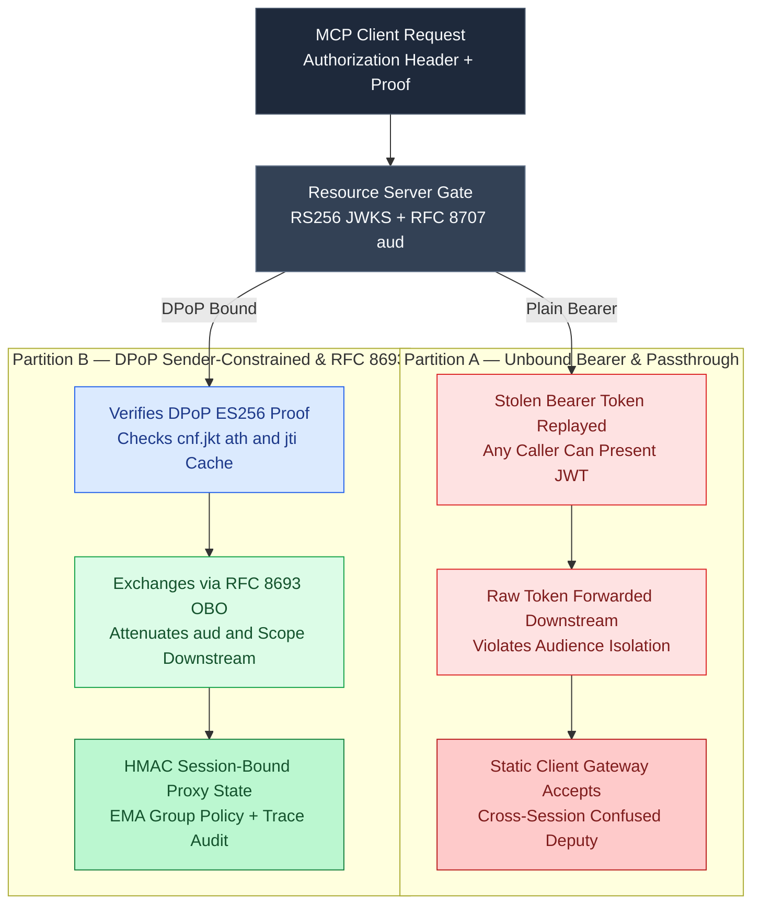

# Securing Model Context Protocol Servers: OAuth 2.1, CIMD, DPoP (RFC 9449), RFC 8693 Token Exchange, and Breaking the Lethal Trifecta

When AI coding assistants and enterprise orchestrators connect to **Model Context Protocol (MCP)** tool servers over Streamable HTTP, a standard API key or static bearer token collapses under enterprise threat models [1, 2]. Five distinct vulnerability classes emerge simultaneously across the MCP boundary: **confused-deputy OAuth proxies**, **audience-free token passthrough** into downstream systems of record, **bearer token replay** if an access token leaks from a gateway log, **tool rug-pulls / prompt poisoning** inside third-party `tools/list` metadata, and the **Lethal Trifecta** (private data access + untrusted external content + outbound exfiltration) [1, 3, 4].

In **[MCP Auth Lab (`mcp-auth-lab`)](https://github.com/akmalkhaniub/mcp-auth-lab)**, we implemented an offline-runnable, Spec-Driven security workbench covering the full OAuth 2.1 MCP authorization stack—from **RFC 9728 Protected Resource Metadata** and **CIMD vs. DCR** registration to **RFC 9449 DPoP sender-constrained tokens**, **RFC 8693 Token Exchange**, and **W3C `traceparent` audit correlation** [1, 2, 5, 6].

---

## 1. Discovery Before Trust, CIMD vs. DCR, and Sender-Constrained DPoP

Under the MCP OAuth 2.1 specification, an unauthenticated request to `/mcp` must never execute or list tools; it must fail closed with `HTTP 401` and an **RFC 9728** `WWW-Authenticate` challenge pointing to `/.well-known/oauth-protected-resource` [1, 2]. Once the client discovers the Authorization Server (`RFC 8414`), it binds the PKCE `S256` authorization code flow to a single **RFC 8707 `resource` (`aud`)** target URI (`https://mcp-expense.local/mcp`) [1].

In multi-vendor IdP deployments, **Dynamic Client Registration (`RFC 7591` DCR)** is frequently disabled by enterprise identity providers such as Microsoft Entra ID to prevent unbounded client sprawl. `mcp-auth-lab` models both **Client ID Metadata Documents (CIMD)**—where HTTPS `client_id` URLs resolve verifiable JSON metadata—and a toggleable DCR mode, while hardening token transport with **RFC 9449 DPoP (Demonstrating Proof-of-Possession)** [5]:



Even if an adversary intercepts a DPoP-bound access token in transit, replaying it via `Authorization: Bearer <token>` or with a mismatched ephemeral keypair fails immediately with `HTTP 401` (`WWW-Authenticate: DPoP error="invalid_dpop_proof", algs="ES256 RS256"`) [5].

---

## 2. RFC 9449 DPoP Verification & Step-Up Scope Challenges

In [`src/mcp_auth_lab/auth.py`](https://github.com/akmalkhaniub/mcp-auth-lab/blob/main/src/mcp_auth_lab/auth.py) and [`src/mcp_auth_lab/mcp_server.py`](https://github.com/akmalkhaniub/mcp-auth-lab/blob/main/src/mcp_auth_lab/mcp_server.py), DPoP proof verification enforces five strict invariants on every token issuance and MCP `tools/call` invocation:

1. **Canonical JWK Thumbprint (`RFC 7638`):** Computes `SHA-256` over the sorted canonical public key members (`crv,kty,x,y` for EC `P-256`), binding it into the minted JWT's `cnf.jkt` claim [5].
2. **Method & URI Binding (`htm` / `htu`):** Rejects proofs minted for `GET` or another endpoint path.
3. **Access Token Hash (`ath`):** Verifies `base64url(SHA-256(access_token))` in constant time (`secrets.compare_digest`).
4. **Freshness & `jti` Anti-Replay Cache:** Rejects proofs outside a `120s` `iat` window or with duplicate `jti` values.
5. **Least-Privilege `tools/list` + Step-Up `insufficient_scope`:** `tools/list` hides unauthorized tools (`approve_expense` is invisible without `expense.approve`), while a direct `tools/call` returns `HTTP 403` with `WWW-Authenticate: Bearer error="insufficient_scope", scope="expense.approve"` so compliant MCP clients can trigger incremental consent [1, 2].

```python
def verify_dpop_proof(
    dpop_header: str,
    *,
    htm: str,
    htu: str,
    access_token: str | None = None,
    seen_jtis: dict[str, float] | None = None,
    max_age_sec: int = 120,
) -> str:
    header = jwt.get_unverified_header(dpop_header)
    if header.get("typ") != "dpop+jwt" or header.get("alg") not in ("ES256", "RS256"):
        raise HTTPException(status_code=401, detail="Invalid DPoP proof header.")
    jwk_dict = header["jwk"]
    pub_key = ECAlgorithm.from_jwk(jwk_dict) if header["alg"] == "ES256" else RSAAlgorithm.from_jwk(jwk_dict)
    claims = jwt.decode(
        dpop_header, pub_key, algorithms=[header["alg"]],
        options={"verify_aud": False, "require": ["jti", "htm", "htu", "iat"]},
    )
    if str(claims["htm"]).upper() != htm.upper() or _normalize_htu(str(claims["htu"])) != _normalize_htu(htu):
        raise HTTPException(status_code=401, detail="DPoP htm/htu binding mismatch.")
    if seen_jtis is not None and str(claims["jti"]) in seen_jtis:
        raise HTTPException(status_code=401, detail="DPoP replay detected: duplicate jti.")
    if access_token is not None:
        expected_ath = base64.urlsafe_b64encode(hashlib.sha256(access_token.encode("ascii")).digest()).rstrip(b"=").decode("ascii")
        if not secrets.compare_digest(str(claims.get("ath", "")), expected_ath):
            raise HTTPException(status_code=401, detail="DPoP ath claim does not bind to access token.")
    return compute_jwk_thumbprint(jwk_dict)
```

---

## 3. Defeating Token Passthrough, Confused Deputy & The Lethal Trifecta

Beyond authentication, `mcp-auth-lab` enforces three runtime containment boundaries across [`gateway.py`](https://github.com/akmalkhaniub/mcp-auth-lab/blob/main/src/mcp_auth_lab/gateway.py), [`downstream_api.py`](https://github.com/akmalkhaniub/mcp-auth-lab/blob/main/src/mcp_auth_lab/downstream_api.py), and [`safety.py`](https://github.com/akmalkhaniub/mcp-auth-lab/blob/main/src/mcp_auth_lab/safety.py):

- **RFC 8693 Token Exchange vs. Passthrough (`INV-AUTH-01`):** Calling the downstream Payroll API with the MCP server's raw token fails with `401` (`aud` mismatch). Only an **RFC 8693** exchanged token attenuated to `aud="https://payroll.internal/api"` and `scope="payroll.read"` (with `act` actor chain) is accepted [6].
- **Gateway Confused Deputy & EMA (`REQ-SEC-05`):** A shared proxy with a static `client_id` binds OAuth `state` via HMAC-SHA256 to the initiator's browser session (`gw_session`) and intersects token scopes against **Enterprise-Managed Authorization (EMA)** group allowlists (`finance-analysts`, `finance-approvers`).
- **Lethal Trifecta & Tool Rug-Pull Pinning (`INV-AUTH-04`, `INV-AUTH-05`):** Once a session reads private receipts (`list_expenses` / `read_receipt`) *and* ingests untrusted external vendor content (`fetch_vendor_doc`), outbound tools (`send_webhook_report`) deterministically block and return a **URL-mode elicitation** challenge instead of risking silent exfiltration [4]. Third-party tool descriptions are scanned for hidden `<important>` prompt-injection tags and pinned via canonical SHA-256 digests (`ToolPinningVerifier`) to quarantine rug-pull mutations.

> [!IMPORTANT]
> Every `tools/call` decision (`allowed`, `denied`, `blocked_trifecta`, `blocked_ssrf`, `passthrough_rejected`) emits a DLP-redacted `AuditLogEntry` tagged with the caller's W3C `traceparent` and `dpop_jkt`, linking security rejections directly to distributed orchestrator traces.

---

## 4. Micro-Benchmark & Security Verification Results

We benchmarked $N = 100$ iterations of `ES256` DPoP proof signing and verification (including `ath` SHA-256 verification and RFC 7638 thumbprint derivation) and ran the full 14-test FastAPI security suite (`uv run pytest -v`):

| Security Operation / Verification Gate | Measured Result | Architectural Guarantee |
| :--- | :--- | :--- |
| **ES256 DPoP Proof Generation (`p50` / `p95`, $N = 100$)** | **`0.244 ms` / `0.939 ms`** | Ephemeral P-256 signing bound to `htm`, `htu`, `jti`, `ath` |
| **DPoP Proof Verification (`p50` / `p95`, $N = 100$)** | **`0.842 ms` / `4.002 ms`** | Blocks stolen Bearer replay, key mismatch, and `jti` replay |
| **RFC 8693 Token Exchange vs. Passthrough** | **`0` passthrough leaks** | Downstream `401` rejection on `aud` mismatch |
| **Full Automated Test Suite (`uv run pytest -v`)** | **`14 / 14 PASSED` (`6.08 s`)** | Covers CIMD/DCR, DPoP, EMA, SSRF, BOLA, and Trifecta |

---

## References & Further Reading

1. Anthropic & Linux Foundation, *"Model Context Protocol (MCP) Authorization Specification (OAuth 2.1, RFC 9728, CIMD),"* 2025–2026.
2. M. Jones, P. Hunt, and A. Parecki, *"RFC 9728: OAuth 2.0 Protected Resource Metadata,"* IETF, 2025.
3. M. Campbell, B. Bradley, and T. Lodderstedt, *"RFC 8707: Resource Indicators for OAuth 2.0,"* IETF, 2020.
4. S. Willison, *"The Lethal Trifecta for AI Agents: Private Data, Untrusted Content, and External Communication,"* Systems Security Notes, 2025.
5. D. Fett, B. Campbell, J. Bradley, T. Lodderstedt, M. Jones, and D. Waite, *"RFC 9449: OAuth 2.0 Demonstrating Proof of Possession (DPoP),"* IETF, 2023.
6. M. Jones, A. Nadalin, B. Campbell, J. Bradley, and C. Mortimore, *"RFC 8693: OAuth 2.0 Token Exchange,"* IETF, 2020.
