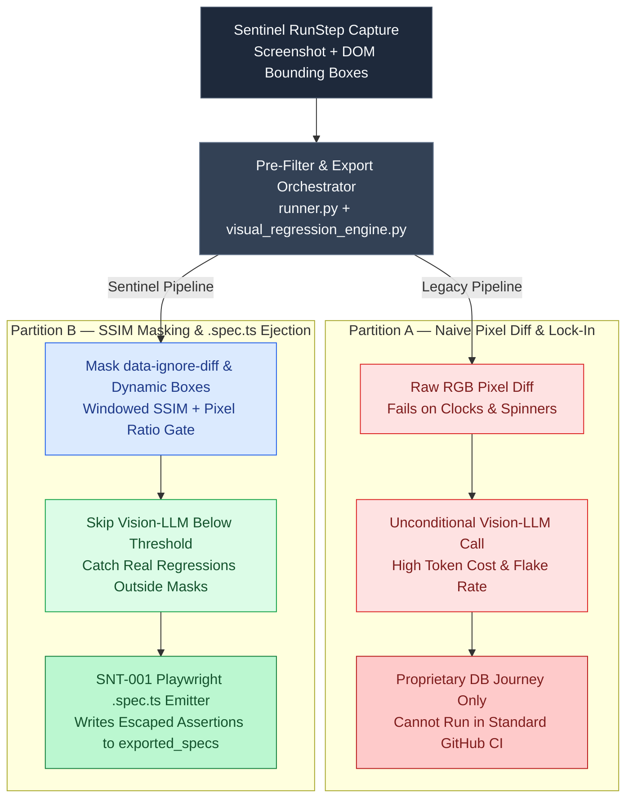

# Zero-Flake Autonomous QA: SSIM Perceptual Masking, Standalone Playwright .spec.ts Ejection, and OWASP LLM Red-Teaming

Autonomous browser agents often fail in production CI pipelines for two opposing reasons: **excessive visual sensitivity** (flagging a ticking UTC timestamp or loading spinner as a UI regression and burning expensive Vision-LLM judge tokens) and **platform lock-in** (trapping recorded user journeys inside proprietary database tables instead of emitting portable, version-controlled test suites) [1, 2].

In **[Sentinel (`sentinel`)](https://github.com/akmalkhaniub/sentinel)**, we resolved both bottlenecks across the core execution runner and security studio: **SSIM perceptual masking** (`visual_regression_engine.py`, `image_diff.py`, `runner.py`) short-circuits Vision-LLM evaluations when changes occur exclusively inside masked dynamic regions, while **SNT-001 Standalone Playwright `.spec.ts` Ejection** (`runner.py`, `code_generator.py`) compiles recorded exploratory journeys into CI-executable TypeScript `@playwright/test` specs saved to `storage/exported_specs/`—complemented by an **OWASP LLM Top-10 Red-Team Guard** (`llm_redteam_auditor.py`) [1, 3, 4].

---

## 1. Perceptual SSIM Masking & Portable `.spec.ts` Ejection Architecture

Naïve pixel-by-pixel diffs treat every dynamic avatar, clock, or spinner frame as a breaking failure, triggering false-positive LLM triage calls. Conversely, Sentinel applies deterministic DOM bounding-box masks before computing **Structural Similarity Index (SSIM)** and pixel mismatch ratios, while compiling finalized journeys into clean TypeScript specs [1, 2]:



---

## 2. Windowed SSIM Perceptual Masking (`SNT-002`)

Before invoking a multimodal judge on a step screenshot, `BrowserHarness.get_dynamic_mask_boxes()` extracts bounding boxes for `[data-ignore-diff]`, project-configured dynamic region selectors, and active spinner elements [1]. Both `compute_pixel_diff()` and `compute_ssim()` in [`image_diff.py`](https://github.com/akmalkhaniub/sentinel/blob/main/image_diff.py) zero out identical masked coordinates across baseline and current frames prior to computing luminance/contrast/structure windows [2]:

- **Zero-Cost Short-Circuit:** If masked pixel difference falls at or below `PIXEL_IDENTICAL_THRESHOLD` (`0.001`), `node_evaluate` skips the Vision-LLM call entirely (`0` judge tokens consumed).
- **Regression Preservation:** Any layout shift or alert banner rendered *outside* the masked bounding box immediately drops SSIM (`< 0.95`) and flags a clustered visual regression.

---

## 3. Standalone Playwright `.spec.ts` Exporter (`SNT-001`)

To eliminate test-runner lock-in, [`runner.py`](https://github.com/akmalkhaniub/sentinel/blob/main/runner.py) (`export_journey_spec_ts` and `export_run_journey_specs`) and [`code_generator.py`](https://github.com/akmalkhaniub/sentinel/blob/main/code_generator.py) serialize every recorded journey—including dataset-expanded steps—into standalone `@playwright/test` TypeScript specs during `finalize_run` or on demand via `GET /api/journeys/{journey_id}/export?language=playwright_ts&save=true`:

```python
def export_journey_spec_ts(
    journey,
    project,
    output_dir: str = "storage/exported_specs",
    steps_override: Optional[List[Dict[str, Any]]] = None,
) -> Dict[str, Any]:
    """Serialize a recorded Journey into a standalone executable `.spec.ts` file."""
    effective_journey = (
        SimpleNamespace(
            id=getattr(journey, "id", None),
            name=getattr(journey, "name", "Sentinel Journey"),
            steps=steps_override,
        )
        if steps_override is not None
        else journey
    )
    code = generate_playwright_ts_script(effective_journey, project)
    slug = _slugify_spec_name(getattr(journey, "name", "journey"))
    filename = f"{slug}.spec.ts"

    out_root = Path(output_dir).resolve()
    out_root.mkdir(parents=True, exist_ok=True)
    target = (out_root / filename).resolve()
    if not target.is_relative_to(out_root):
        raise ValueError(f"Unsafe spec export path: {filename}")
    target.write_text(code, encoding="utf-8")
    return {
        "filename": filename,
        "path": str(target),
        "code": code,
        "selectors_count": sum(1 for s in (getattr(effective_journey, "steps", None) or []) if (s.get("selector") or "").strip()),
        "assertions_count": code.count("expect("),
    }
```

Key compiler invariants enforced by `generate_playwright_ts_script`:
1. **Strict String & Selector Escaping:** Escapes backslashes, single quotes, and newlines (`_escape_js_str`) so inputs like `SAVE'20\NOW` or attribute selectors (`input[name='coupon']`) never break TypeScript compilation.
2. **Deterministic Assertions:** Emits `await expect(page.locator(...)).toBeVisible()` before clicks/fills, `toHaveValue(...)` after typing, and `toContainText(...)` / `toHaveURL(...)` assertions from step expectations.
3. **Path-Traversal Confinement:** Sanitizes arbitrary journey names (e.g., `../../etc/passwd Checkout` $\rightarrow$ `etc_passwd_checkout.spec.ts`) and verifies `target.is_relative_to(out_root)`.

---

## 4. OWASP LLM Top-10 Red-Teaming & MCP QA Bridge

Modern web apps increasingly embed RAG chatbots and tool-calling copilots inside the DOM. Alongside Playwright E2E verification, [`llm_redteam_auditor.py`](https://github.com/akmalkhaniub/sentinel/blob/main/llm_redteam_auditor.py) evaluates embedded AI endpoints against five OWASP LLM Top-10 adversarial probes (`LLM01-DIRECT-INJ`, `LLM01-INDIRECT-DOM` hidden `<span style='display:none'>` instructions, `LLM06-PII-RAG` cross-tenant leakage, `LLM07-SYS-LEAK`, and `LLM08-TOOL-ABUSE`), while [`sentinel_mcp_bridge.py`](https://github.com/akmalkhaniub/sentinel/blob/main/sentinel_mcp_bridge.py) exposes `sentinel_get_findings`, `sentinel_heal_selector`, and `sentinel_export_sarif` over MCP so coding agents can auto-remediate regressions [3, 4, 5].

> [!TIP]
> Combining `storage/exported_specs/*.spec.ts` with OASIS SARIF v2.1.0 outputs lets engineering teams run Sentinel for autonomous exploration in staging while executing zero-dependency Playwright specs directly inside pull-request GitHub Actions runners.

---

## 5. Micro-Benchmark & Verification Results

We benchmarked standalone `.spec.ts` compilation (`N = 100`) and masked $640 \times 480$ SSIM evaluation (`N = 50`), and ran Sentinel's full 130-test `pytest` suite after the `SNT-001` implementation:

| Verification / Benchmark Metric | Measured Result | Architectural Guarantee |
| :--- | :--- | :--- |
| **Standalone `.spec.ts` Export (`N = 100`)** | **`2.3661 ms` p50 / `3.2305 ms` p95** | Zero-overhead TypeScript compilation + disk write on finalize |
| **Masked SSIM (`640 x 480`, `N = 50`)** | **`511.11 ms` p50 / `858.53 ms` p95** | `SSIM = 1.0` on masked dynamic timestamps; skips Vision-LLM |
| **Full Sentinel Test Suite (`pytest tests -q`)** | **`130 / 130 PASSED` (`94.83 s`)** | Covers SSIM masking, `.spec.ts` syntax/escaping, MCP, and CI gates |

---

## References & Further Reading

1. Microsoft Playwright Team, *"Playwright Test (`@playwright/test`) Locators, Auto-Waiting & Web-First Assertions,"* 2026.
2. Z. Wang, A. C. Bovik, H. R. Sheikh, and E. P. Simoncelli, *"Image Quality Assessment: From Error Visibility to Structural Similarity,"* IEEE Transactions on Image Processing, vol. 13, no. 4, pp. 600–612, 2004.
3. OWASP Foundation, *"OWASP Top 10 for Large Language Model Applications v2.0 (LLM01 Prompt Injection, LLM06 Sensitive Info Disclosure, LLM08 Excessive Agency),"* 2025.
4. OASIS Open, *"Static Analysis Results Interchange Format (SARIF) Version 2.1.0,"* OASIS Standard, 2020.
5. Anthropic & Linux Foundation, *"Model Context Protocol (MCP) Specification,"* 2025–2026.
