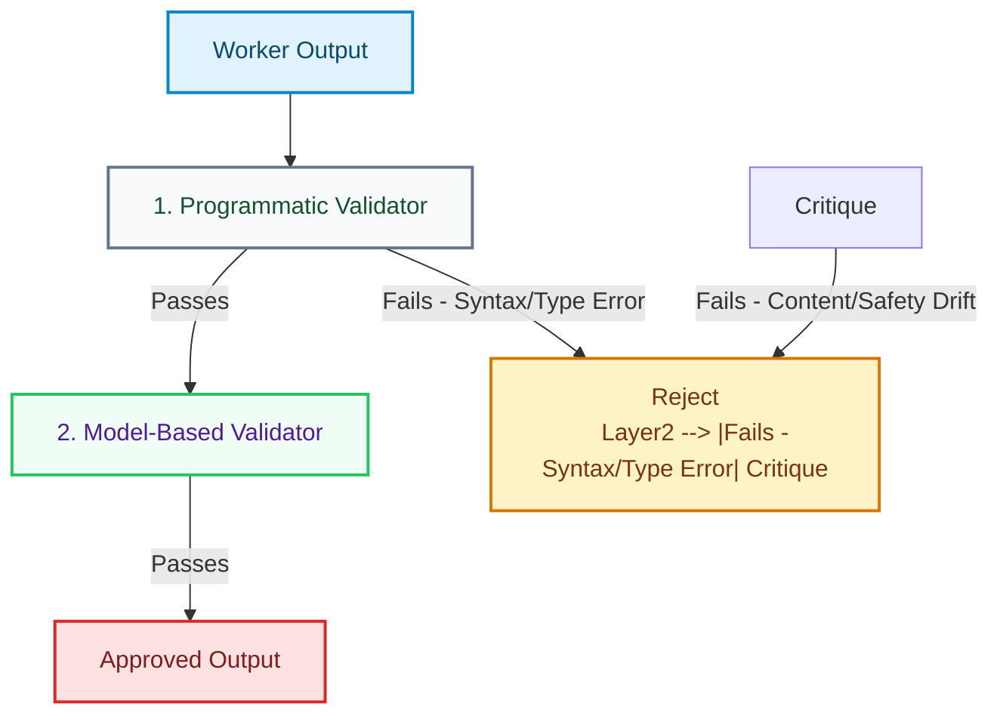

> ### 📖 Article Overview
> * **What this article is about:** This article explains how to overcome LLM confirmation bias by separating generation from verification using the Validator Agent Pattern.
> * **Why it matters:** Relying on a single agent for both generation and self-evaluation leads to bug-ridden deployments, whereas a dedicated validation layer ensures reliable, secure, and cost-effective AI outputs.
> * **What we synthesized:** We synthesized a two-layer validation architecture that combines deterministic programmatic checks with LLM-as-a-judge model validators, governed by a strict verification contract.

---

In software engineering, letting developers run their own manual QA on their code without testing standards is a known path to bug-ridden deployments [1]. Yet, in generative AI systems, developers routinely instruct a single agent to write code and verify its correctness in the same context window.

This self-evaluation pattern fails because Large Language Models suffer from a systemic **confirmation bias**. Once a model outputs a generation, it tends to read past its own bugs in subsequent steps, declaring its own work "valid."

To build reliable systems, we must separate generation from verification using the **Validator Agent Pattern**.

---

## Programmatic vs. Model-Based Validators

A validator agent is a dedicated node in your system design whose sole responsibility is to evaluate a worker's output against a **Verification Contract**. Validators should be structured in two distinct layers, executing in a strict sequence:



### 1. Programmatic Validators (Rule-Based Gates)
Before invoking a model to evaluate output, run strict, rule-based code checks. Programmatic checks are deterministic, execute in milliseconds, and consume zero tokens.
*   **Syntax & Compilers**: Run compilers (e.g., `tsc` for TypeScript) or syntax parsers (e.g., python's `ast.parse`) to verify code compiles.
*   **Testing Suites**: Execute unit tests (e.g., `pytest`, `vitest`) inside a sandboxed container, capturing the exact stack traces.
*   **Schema Checkers**: Validate that JSON outputs match Pydantic or JSON Schema structures exactly.

### 2. Model-Based Validators (LLM-as-a-Judge)
If the output compiles and passes structural checks, route it to a separate model-based validator. This node evaluates subjective quality, compliance, and semantic drift.
*   **Role Isolation**: The model-based validator must use a distinct system prompt configured for criticism. It should *never* share the generation history or prompt files of the worker.
*   **Strict Grading Rubrics**: Provide the validator with a structured rubric (e.g., "Score the explanation from 1 to 5 on clarity, safety, and source alignment. Reject any score below 4").

---

## Designing the Verification Contract

When the Orchestrator delegates a task to a Worker, it must output a **Verification Contract** alongside the task instructions. The contract defines:
1.  **Structural Bounds**: Required variables, import statements, or JSON keys.
2.  **Functional Bounds**: Specific unit tests or regex schemas the output must satisfy.
3.  **Safety Bounds**: Content filters, brand compliance rules, and PII detection criteria.

If the Validator flags a contract violation, it compiles a structured critique:
```json
{
  "status": "failed",
  "reason": "Test case 'test_negative_balance' failed with AssertionError.",
  "failed_lines": [43, 44],
  "critique": "The transaction calculation allowed a negative balance. Ensure the worker locks the row and checks balance boundaries before debiting."
}
```
This critique is piped back to the Worker, which runs again with the critique as context.

---

## The Validation Gate Checklist

*   [ ] **Strict Pipeline Sequence**: Always run programmatic checks (linters, test suites) *first*. If a test fails, terminate or loop back immediately without calling the expensive validator model.
*   [ ] **Model Decoupling**: If the Worker uses Claude Opus, use a faster, cheaper model (like Claude Sonnet or GPT-4o-mini) for the validator node to optimize latency and costs.
*   [ ] **Loop Escape Valve**: Enforce a hard ceiling on the critique loop (maximum 3 iterations). If the worker cannot satisfy the validator after 3 turns, escalate to a **Human-in-the-Loop breakpoint**.

---

## Conclusion & Key Takeaways

Implementing a robust validation architecture is essential for transitioning generative AI agents from experimental prototypes to production-ready systems.
1. **Overcoming Confirmation Bias:** LLMs suffer from systemic confirmation bias and cannot reliably evaluate their own outputs in the same context window. Separating the worker and validator roles is critical for accuracy.
2. **Two-Layer Validation Pipeline:** Always run fast, cost-effective programmatic checks (like syntax parsers and test suites) before routing outputs to more expensive model-based LLM-as-a-judge validators.
3. **Strict Verification Contracts:** Define clear structural, functional, and safety bounds for outputs, and enforce a loop escape valve to prevent infinite critique loops and optimize latency.

*Takeaway: Decoupling generation from verification is the key to eliminating LLM confirmation bias and building highly reliable, self-correcting agentic workflows.*

---

---

## Antithesis & Production Trade-Offs: When NOT to Use This Architecture

Even a high-throughput **AI Agents, Validation** architecture introduces non-trivial operational complexity. Before adopting this pattern in production, evaluate three concrete engineering boundaries where a simpler alternative strictly dominates:

1. **Low-Throughput / Single-Node Workloads ($< 50	ext{ req/s}$):**
   If your service operates well below saturation on a single vertical instance and does not face strict multi-tenant tail-latency SLAs (`p99 < 50 ms`), the bookkeeping overhead of two-tier state partitioning, canonical digest hashing, and sliding-window circuit breakers adds cognitive and operational cost without measurable user-facing gains. A single monolithic transaction boundary with standard database constraints is simpler to debug and operate.
2. **Hard Real-Time Ultra-Low-Latency Paths ($< 50\,\mu	ext{s}$ Budget):**
   When operating inside kernel-bypass networking, L1/L2 cache-pinned ring buffers, or per-packet hardware data planes, any dynamic heap allocation, cryptographic SHA-256 digest computation, or asynchronous context switch violates the nanosecond/microsecond budget. In those regimes, pre-compute static lookup tables at control-plane configuration time and keep the hot path strictly zero-allocation.
3. **Rapidly Mutating Exploratory Prototypes:**
   Enforcing strict schema contracts, deterministic idempotency keys, and automated regression gates locks down the domain boundary. During week-one exploratory product discovery—where underlying data models change daily and zero real customer capital or tenant PII is at risk—defer heavy verification harnesses until the core workflow contract stabilizes.

---

## References & Further Reading

*   **Reflexion Framework**: Shinn et al., 2023. *Reflexion: Language Agents with Active Generative Feedback*. Explains the systematic benefits of separating execution from critic loops. [arXiv:2303.11366](https://arxiv.org/abs/2303.11366)
*   **LLM-as-a-Judge**: Zheng et al., 2023. *Judging LLM-as-a-Judge with MT-Bench and Chatbot Arena*. System evaluation guidelines and biases when using model judges. [arXiv:2306.05685](https://arxiv.org/abs/2306.05685)
*   **VMAO Framework**: *Verified Multi-Agent Orchestration: A Plan-Execute-Verify-Replan Framework* (March 2026). Explains verification-driven agent replanning. [arXiv:2603.10952](https://arxiv.org/abs/2603.10952) (Needs verification)

*To explore complete code implementations of all 17 agent microservices in a single monorepo, check out the public [agentic-apps-portfolio](https://github.com/akmalkhaniub/agentic-apps-portfolio) repository.*