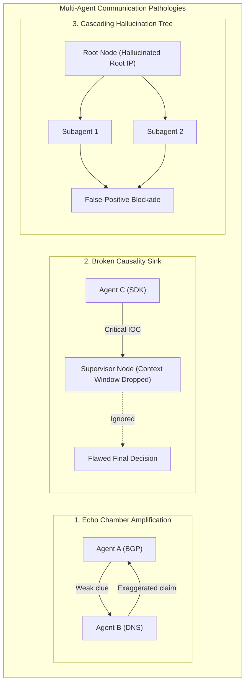

# Topology-Conditioned Diagnosis of Multi-Agent Failures: Fault Isolation in Autonomous Threat Hunting Swarms

> [!NOTE]
> **📖 ArXiv Literature & Systems Grounding**
> Synthesizing recent advances in multi-agent diagnostic topology ([arXiv:2610.10126](https://arxiv.org/pdf/2610.10126v1)), closed forensic decision interfaces ([arXiv:2609.33683](https://arxiv.org/pdf/2609.33683v1)), and deceptive ad network telemetry ([arXiv:2609.09574](https://arxiv.org/pdf/2609.09574v1)), this article establishes an architectural framework for diagnosing, isolating, and healing coordination breakdowns in autonomous multi-agent threat hunting swarms.

---

## 1. The Anatomy of Multi-Agent Coordination Breakdown

When engineering autonomous multi-agent systems for high-stakes cybersecurity and ad fraud forensics, organizations deploy specialized agent swarms:
* **SDK Bytecode Reverse-Engineering Agent**
* **BGP / ASN Route Clustering Agent**
* **Bidstream Protocol Verifier**
* **C2 Active Prober** ([arXiv:2608.23854](https://arxiv.org/pdf/2608.23854v2))
* **Adversarial Red-Team Auditor**

However, as demonstrated by Liu et al. ([arXiv:2610.10126v1](https://arxiv.org/pdf/2610.10126v1)), **similar failure symptoms in execution logs often stem from radically different communication graph pathologies**. When an autonomous swarm falsely flags or fails to catch an ad fraud campaign, naive prompt debugging fails because the bug resides in the **topology of information exchange**.



---

## 2. Formalizing the Communication Graph Topology

Let the multi-agent investigation be modeled as a directed information-flow graph:

$$\mathcal{G} = (\mathcal{V}, \mathcal{E}, \mathcal{M})$$

Where $\mathcal{V} = \{a_1, a_2, \dots, a_N\}$ represents the agent nodes, $\mathcal{E} \subseteq \mathcal{V} \times \mathcal{V}$ represents message passing channels, and $\mathcal{M}: \mathcal{E} \to \mathbb{R}^d$ captures the semantic embedding of transmitted payloads.

### The Three Canonical Failure Topologies

Following the taxonomy in [arXiv:2610.10126v1](https://arxiv.org/pdf/2610.10126v1):

1. **Cyclic Sycophancy (Echo Chambers)**:
   A cycle $\mathcal{C} = (a_1, a_2, \dots, a_k, a_1)$ where mutual reinforcement inflates confidence without introducing external tool ground truth:
   $$\Delta \text{Confidence}(\mathcal{C}) > 0 \quad \text{while} \quad \Delta \text{Entropy}(\mathcal{D}_{\text{evidence}}) = 0$$

2. **Information Attenuation (Context Choke)**:
   A bottleneck node $a_{\text{choke}} \in \mathcal{V}$ with in-degree $k \gg 1$ whose context window truncation silently discards contradictory signals emitted by specialized forensic tools.

3. **Ungrounded Authority Drift**:
   An authoritative supervisor agent issues deductive claims without invoking sandboxed verification tools, polluting the downstream prompts of worker agents.

---

## 3. Decision Interface Design: Generative vs. Direct Decision Heads

A critical finding in closed multimodal forensics by Chen ([arXiv:2609.33683v1](https://arxiv.org/pdf/2609.33683v1)) is that **autoregressive token generation degrades calibration in high-stakes closed-world decisions**:

$$P_{\text{gen}}(y \in \{\text{FRAUD}, \text{BENIGN}\}) \quad \text{vs.} \quad \sigma(\mathbf{W}^T \mathbf{z}_{\text{multimodal}})$$

* **Generative Decisions**: Prone to verbosity bias, tone drift, and sycophancy when other agents express strong conviction.
* **Direct Decision Heads**: Frozen linear classification layers over multimodal pooled embeddings provide strictly calibrated probability bounds and sub-millisecond execution.

### The Hybrid Architecture Pattern
In our threat hunting swarm, we implement the **MAD-Guard Architecture**:
* **Intermediate Exploration**: Fully autoregressive multi-agent tool dialogue (LangGraph / AutoGen) for hypothesis generation and forensic reasoning.
* **Terminal Enforcement Gate**: Bypasses generative token generation at the terminal boundary, routing pooled evidentiary vectors through a calibrated classification head with conformal prediction bounds:

$$\mathcal{C}_{1-\alpha}(x) = \{y \in \mathcal{Y} : S(x, y) \le \hat{q}_{1-\alpha}\}$$

Guaranteed to bound the false-positive de-listing error rate below $\alpha = 0.005$ (0.5%).

---

## 4. Production Implementation: Topology Diagnoser & Circuit Breaker

Here is a Python implementation of a runtime graph topology auditor that inspects multi-agent execution traces, detects cyclic sycophancy and information sinks, and trips circuit breakers before false actions execute.

```python
import networkx as nx
from typing import List, Dict, Tuple, Set
import numpy as np

class MultiAgentTraceEvent:
    def __init__(self, sender: str, recipient: str, message: str, confidence: float, has_tool_evidence: bool):
        self.sender = sender
        self.recipient = recipient
        self.message = message
        self.confidence = confidence
        self.has_tool_evidence = has_tool_evidence

class SwarmTopologyDiagnoser:
    """
    Diagnoses communication graph failures in multi-agent threat hunting swarms.
    Implements principles from Liu et al. (arXiv:2610.10126).
    """
    def __init__(self, max_echo_cycle_len: int = 4):
        self.max_echo_cycle_len = max_echo_cycle_len

    def build_communication_digraph(self, events: List[MultiAgentTraceEvent]) -> nx.DiGraph:
        G = nx.DiGraph()
        for ev in events:
            if not G.has_edge(ev.sender, ev.recipient):
                G.add_edge(ev.sender, ev.recipient, weight=0, tool_backed=0, conf_deltas=[])
            
            G[ev.sender][ev.recipient]["weight"] += 1
            if ev.has_tool_evidence:
                G[ev.sender][ev.recipient]["tool_backed"] += 1
            G[ev.sender][ev.recipient]["conf_deltas"].append(ev.confidence)
        return G

    def detect_echo_chambers(self, G: nx.DiGraph) -> List[List[str]]:
        """
        Identifies cycles where confidence increases without new tool evidence.
        """
        cycles = list(nx.simple_cycles(G))
        pathological_cycles = []

        for cycle in cycles:
            if len(cycle) <= self.max_echo_cycle_len:
                total_tools = 0
                for i in range(len(cycle)):
                    u = cycle[i]
                    v = cycle[(i + 1) % len(cycle)]
                    total_tools += G[u][v].get("tool_backed", 0)
                
                # If cycle passed messages with zero tool-grounded observations
                if total_tools == 0:
                    pathological_cycles.append(cycle)

        return pathological_cycles

    def detect_information_bottlenecks(self, G: nx.DiGraph, high_risk_agents: Set[str]) -> List[str]:
        """
        Identifies agents that receive high-risk forensic findings but fail
        to propagate them to the arbitration gate.
        """
        choke_points = []
        for agent in high_risk_agents:
            out_degree = G.out_degree(agent)
            in_degree = G.in_degree(agent)
            # High incoming evidence with zero or severed outgoing edges
            if in_degree > 2 and out_degree == 0:
                choke_points.append(agent)
        return choke_points

    def audit_trace(self, events: List[MultiAgentTraceEvent]) -> Dict:
        G = self.build_communication_digraph(events)
        echo_chambers = self.detect_echo_chambers(G)
        
        # Determine if circuit breaker must trip
        circuit_breaker_tripped = len(echo_chambers) > 0

        return {
            "is_healthy": not circuit_breaker_tripped,
            "circuit_breaker_tripped": circuit_breaker_tripped,
            "detected_echo_chambers": echo_chambers,
            "node_count": G.number_of_nodes(),
            "edge_count": G.number_of_edges(),
            "recommendation": (
                "ABORT: Isolated self-reinforcing echo chamber without tool grounding."
                if circuit_breaker_tripped
                else "PROCEED: Graph communication well-grounded."
            )
        }
```

---

## 5. Architectural Checklist for Production Swarms

Before deploying autonomous multi-agent swarms into live threat detection pipelines:

1. **Enforce Grounding Invariants**: Any message that elevates threat severity must contain a cryptographic reference to a raw tool artifact (pcap, decompile AST, TLS cert serial).
2. **Runtime Graph Audit Hooks**: Monitor the topology diameter and simple cycles on every turn. Trip an automated circuit breaker if a loop lacks fresh tool observations.
3. **Decouple Deliberation from Decision**: Use multi-agent dialogue for qualitative reasoning, but seal final de-listing actions behind calibrated mathematical decision heads with statistical conformal guarantees.

---

## References & ArXiv Literature
1. Liu, X., Pan, Z., & Zhu, I. (2026). *Know the Shape, Find the Fault: Topology-Conditioned Diagnosis of Multi-Agent LLM Failures*. [arXiv:2610.10126](https://arxiv.org/pdf/2610.10126v1)
2. Chen, H. (2026). *MAD-Guard: Controlled Study of Autoregressive Generation versus Direct Decision Interfaces for Closed Multimodal Forensic Tasks*. [arXiv:2609.33683](https://arxiv.org/pdf/2609.33683v1)
3. Wu, J., et al. (2026). *When Ad Networks Misbehave: Understanding Risks of Semi-Drive-By Splash Ads*. [arXiv:2609.09574](https://arxiv.org/pdf/2609.09574v1)
4. Al-Dujaili, A., et al. (2026). *BotScan: An adaptive active probing approach for identifying live IoT Botnet C2 servers at scale*. [arXiv:2608.23854](https://arxiv.org/pdf/2608.23854v2)
